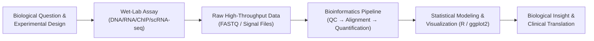
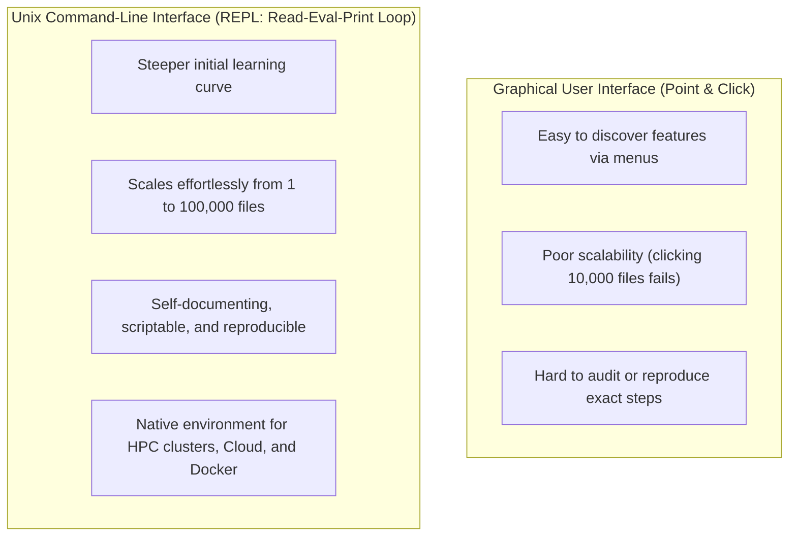

# Week 1: Introduction to Bioinformatics & Computer Setup — Core Concepts & Visualizations

**Course:** Applied Bioinformatics for Genomics (BIOL 5624 / BFX Workshop 2025–2026)  
**Instructor:** Chris Miller, Ph.D. (TA: John Garza; ICTS Precision Health: Jenny McKenzie)  
**Transcription Model:** Whisper `large-v3-turbo` (`week_01_lecture.txt` / `week_01_lecture.srt`)

---

## 1. Course Overview & Philosophy: Why Bioinformatics?

Modern biology has transitioned from purely observational or small-scale wet-lab experiments to a **quantitative, data-intensive discipline**. High-throughput sequencing and multi-omic technologies generate gigabytes to terabytes of data per experiment, creating a bottleneck between data generation and biological insight.



### Core Goals of the Workshop
1. **Theory + Practice:** Pair each biological or genomic assay concept with the exact command-line and statistical tools used to analyze it.
2. **Empowerment & Reproducibility:** Enable researchers to inspect raw data, write reproducible scripts, and run containerized bioinformatics workflows rather than relying on opaque point-and-click tools.
3. **Healthy Skepticism ("Don't Trust Your Data"):**
   > *"Analyzing your data means inherently distrusting your data until you have exhausted yourself into giving up and trusting it."* — Aaron Quinlan

---

## 2. Why Data Visualization and Controls Matter in Computational Biology

Summary statistics alone (means, standard deviations, $p$-values) can mask severe artifacts or completely different underlying distributions (**Anscombe's Quartet** / **Datasaurus Dozen**).

```
Anscombe's Quartet / Datasaurus Principle:
Identical Mean (x, y), Variance (x, y), Correlation (r), and Linear Regression Line
┌────────────────────┐  ┌────────────────────┐  ┌────────────────────┐  ┌────────────────────┐
│      .  .  .       │  │       . . .        │  │              .     │  │         *          │
│    .  .  .         │  │    .         .     │  │          . .       │  │     *       *      │
│  .  .  .           │  │  .             .   │  │      . .           │  │     *   *   *      │
│ .  .               │  │ .               .  │  │  . .        o      │  │       * * *        │
└────────────────────┘  └────────────────────┘  └────────────────────┘  └────────────────────┘
  Linear + Noise          Non-linear Curve       Linear + 1 Outlier       Complex Shape/Artifact
```

### Real-World Consequences of Unchecked Bioinformatics Pipelines
In the lecture, Dr. Miller highlights a high-profile case study (**Reddy et al., *Cell* 2017**, diffuse large B-cell lymphoma exome sequencing) where inadequate quality control and improper variant filtering led to **errors of commission (Type I / False Positives)** and **errors of omission (Type II / False Negatives)**:

| Error Type | Statistical Name | Bioinformatics Example | Prevention Strategy |
| :--- | :--- | :--- | :--- |
| **Commission** | Type I Error (False Positive) | Calling a PCR artifact, paralogous alignment, or germline SNP as a somatic mutation | Matched normal controls, population databases (gnomAD), IGV manual review |
| **Omission** | Type II Error (False Negative) | Failing to detect a known driver mutation (e.g., *TP53* or *MYD88*) | Positive control spike-ins, coverage QC, multi-caller consensus |

---

## 3. How We Interact with Computers: GUI vs. Command-Line Interface (CLI)

From early plugboard computers (ENIAC) and punch cards to modern interactive terminals (**DEC VT100**) and Graphical User Interfaces (**GUIs**), computing interfaces trade off ease of entry against automation power.



### Power of the Unix Shell: Concrete Example from Lecture
Suppose an event date (`Apr 2020`) needs to be updated to `Oct 2024` across **10,000 `.txt` files** nested in hundreds of subdirectories:

```bash
find . -name "*.txt" | xargs -n 1 sed -i.bak 's/Apr 2020/Oct 2024/g'
```

```
[ find . -name "*.txt" ] ──(streams 10,000 paths)──► [ xargs -n 1 ] ──► [ sed -i.bak 's/Apr 2020/Oct 2024/g' ]
```

---

## 4. Software Stack & Year-Long Curriculum Roadmap (Weeks 1–24)

| Tool | Role in the BFX Workshop | Key Setup / Verification Command |
| :--- | :--- | :--- |
| **Unix Shell (`bash`/`zsh`)** | Lingua franca of bioinformatics; runs pipelines and scripts | `ls`, `pwd`, `cd` ([sandbox.bio](https://sandbox.bio/tutorials?id=terminal-basics)) |
| **Miniconda (`conda`)** | Manages Python/R packages and isolated environments | `conda -h`, `python -V` |
| **Jupyter Notebook** | Interactive notebooks combining code, plots, and markdown | `conda install jupyter` |
| **Docker** | Runs pre-packaged bioinformatics software containers | `docker run hello-world` |
| **Git** | Clones and updates course materials and scripts | `git clone https://github.com/genome/bfx-workshop.git` |
| **IGV & RStudio** | Desktop genome browser (`igv.org`) and statistical IDE | Desktop applications |
