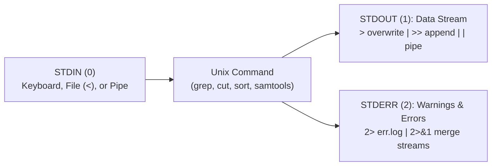

# Week 2: Introduction to the Unix Shell — Core Concepts & Visualizations

**Course:** Applied Bioinformatics for Genomics (BFX Workshop 2025–2026)  
**Instructor:** Chris Miller, Ph.D.  
**Transcription Model:** Whisper `large-v3-turbo` (`week_02_lecture.txt` / `week_02_lecture.srt`)

---

## 1. Unix File System Hierarchy & Navigation

Every file and directory in Unix lives in an inverted tree rooted at `/` (the root directory). Understanding **absolute paths** (starting from `/`) versus **relative paths** (starting from your current working directory `.`) is essential for running bioinformatics tools.

```
/ (Root)
└── home/ (or /Users on macOS)
    └── cmiller/  (Home directory: ~)
        └── workshop/
            └── bfx-workshop/
                └── lectures/
                    └── week_02/   <-- Current Working Directory (pwd)
                        ├── tcga.tsv
                        ├── genes1.txt
                        └── unix_command_line.md
```

| Command / Shortcut | Meaning | Example |
| :--- | :--- | :--- |
| `pwd` | Print working directory | `pwd` $\rightarrow$ `/home/cmiller/workshop/bfx-workshop/lectures/week_02` |
| `ls` / `ls -la` | List directory contents (`-l` long details, `-a` hidden dotfiles) | `ls -lh *.tsv` |
| `cd <path>` | Change directory (`cd ~` or `cd` = home; `cd ..` = up one level; `cd -` = previous dir) | `cd ../week_03` |
| `mkdir` / `rmdir` | Create directory (`mkdir -p` creates parent dirs) / remove empty directory | `mkdir -p results/qc` |
| `cp` / `mv` / `rm` | Copy, move/rename, or permanently delete files (no Recycle Bin!) | `mv testdir testdir.new` |
| `Tab` / `↑` / `Ctrl-R` | Autocomplete paths (`Tab`), cycle history (`↑`), reverse-search command history (`Ctrl-R`) | `history \| grep python` |
| `Ctrl-C` / `q` / `:q!` | Kill stuck process (`Ctrl-C`), exit `less` (`q`), exit `vim` without saving (`Esc` then `:q!`) | — |

---

## 2. File & Sample Naming Best Practices in Genomics

Poorly named files break command-line scripts and cause lexicographical sorting bugs:

| Anti-Pattern (Bad Name) | Why It Fails in Unix | Recommended Fix |
| :--- | :--- | :--- |
| `Mouse Sample A.txt` | **Spaces** split arguments (`sort` looks for 3 files: `"Mouse"`, `"Sample"`, `"A.txt"`) | `Mouse_Sample_A.txt` |
| `sample123_Tp53+/-_het&Dox*.txt` | **Special shell characters** (`*`, `&`, `/`, `+`) trigger wildcard expansion or backgrounding | `sample123_Tp53_het_plus_Dox.txt` |
| `-sample123.txt` | **Leading hyphen (`-`)** is parsed as a command-line flag (`invalid option`) | `sample_123.txt` |
| `sample1.tsv`, `sample2.tsv`, ..., `sample10.tsv` | **Unpadded numbers** sort lexicographically (`sample1`, `sample10`, `sample11`, `sample2`) | Zero-pad: `sample01.tsv`, `sample02.tsv`, ..., `sample10.tsv` |
| `sample637`, `sample647` | **Opaque names** lack metadata context | `Mouse_637_TP53_KO_WGBS.tsv` |

---

## 3. Standard Streams (`STDIN`, `STDOUT`, `STDERR`), Redirection & Pipes

Every Unix process has one input channel and two separate output channels, allowing data (`STDOUT`) to be piped or saved cleanly without being polluted by warning/error messages (`STDERR`):



| Operator | Action | Example |
| :--- | :--- | :--- |
| `>` | Redirect `STDOUT` to a file (**overwrites** existing file) | `echo "Hello" > hi.txt` |
| `>>` | Redirect `STDOUT` to a file (**appends** to end of file) | `date >> run.log` |
| `2>` | Redirect `STDERR` to an error log file | `date --badflag 2> error.log` |
| `> file 2>&1` | Redirect both `STDOUT` and `STDERR` to the same file | `bash pipeline.sh > run.log 2>&1` |
| `\|` (Pipe) | Connect `STDOUT` of command A directly to `STDIN` of command B | `cut -f 8 tcga.tsv \| sort \| uniq -c` |
| `<(cmd)` | **Process substitution:** treat output of `cmd` as a virtual file path | `comm -12 <(sort genes1.txt) <(sort genes2.txt)` |

---

## 4. Tabular Data Wrangling & Homework Solution (`tcga.tsv`)

Bioinformatics tables (like `tcga.tsv`, `BED`, `VCF`, `SAM`) can be queried rapidly by chaining small, single-purpose Unix utilities:

```
tcga.tsv ──► [ cut -f 8 ] ──► [ sort ] ──► [ uniq -c ] ──► [ sort -nr ] ──► [ head -n 10 ]
             Extract col 8    Group same   Count occurrences  Sort highest   Top 10 mutated
             (Gene Symbol)    genes        per unique gene    count first    genes in cohort
```

### Core Text-Processing Commands Practiced in Lecture
```bash
# 1. Inspect file dimensions, headers, and column structure without flooding terminal
wc -l tcga.tsv
head -n 5 tcga.tsv | column -t | less -S

# 2. Deduplicate and compare two gene lists (genes1.txt vs genes2.txt) using comm
sort genes1.txt | uniq > genes1.uniq.txt
sort genes2.txt | uniq > genes2.uniq.txt
comm -12 genes1.uniq.txt genes2.uniq.txt   # Genes present in BOTH files (intersection)

# 3. Loops and xargs for batch automation
for i in 1 2 3 4; do echo "Sample $i"; done
cat genes1.txt | xargs -n 1 echo

# 4. Reorder columns preserving tab delimiters with awk
awk -F"\t" -v OFS="\t" '{print $2, $1}' tcga.tsv | head

# 5. Week 2 Homework Solution: Total number of ASXL1 mutations in tcga.tsv
cut -f 8 tcga.tsv | grep -w "ASXL1" | wc -l
```
