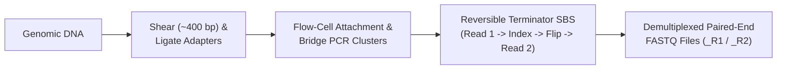

# Week 3: DNA Sequence Generation, Formats & QC — Core Concepts & Visualizations

**Course:** Applied Bioinformatics for Genomics (BFX Workshop 2025–2026)  
**Instructor:** Chris Miller, Ph.D.  
**Transcription Model:** Whisper `large-v3-turbo` (`week_03_lecture.txt` / `week_03_lecture.srt`)

---

## 1. Evolution of DNA Sequencing Technologies

### First-Generation: Sanger Chain-Termination Sequencing (1977–1999)
- **Mechanism:** Sequencing by synthesis using DNA polymerase, standard deoxynucleotides (`dNTPs`), and a low percentage (~1%) of fluorescently labeled **dideoxynucleotide chain terminators (`ddNTPs`)** lacking a $3'\text{-OH}$ group.
- **Throughput Scaling:**
  - **1977 (Manual slab gels):** ~700 bp/day (~118,000 years per human genome).
  - **1999 (ABI 3700 96-capillary electrophoresis):** ~400,000 bp/day (~205 years per human genome).

### Second-Generation: Illumina Massively Parallel Sequencing (2006–Present)
1. **Library Preparation:** Acoustic shearing of genomic DNA into ~400 bp fragments, followed by ligation of flow-cell binding adapters, sequencing primer sites, and sample barcode indices.
2. **Bridge PCR Cluster Amplification:** Single-stranded fragments hybridize to lawn oligos on a glass flow cell and undergo clonal bridge amplification into millions/billions of tight clusters.
3. **Reversible Terminator Sequencing-by-Synthesis (SBS):** Each cycle adds 4 fluorescently labeled reversible terminators, images the flow cell, cleaves the fluorophore + $3'$ blocker, and repeats for 100–150 cycles.



### Paired-End Sequencing Geometry
```
        <────── 500 bp DNA Fragment (Insert Size) ──────>
5' ═════[Adapter]═══════════════════════════════════════[Adapter]═════ 3'
                 ├─────────────►         ◄─────────────┤
                  Read 1 (150 bp)         Read 2 (150 bp)
                  |<─── ~200 bp Unsequenced Inner Gap ───>|
```
- **Why Paired-End?** Even though each read is only 150 bp, knowing that Read 1 and Read 2 originate ~500 bp apart in inward-facing (`FR`) orientation anchors repetitive elements and reveals structural variants (deletions, insertions, inversions, translocations).

### Third-Generation: Single-Molecule Long-Read Technologies
| Platform | Mechanism | Typical Read Length | Raw Error Profile & Epigenetics |
| :--- | :--- | :--- | :--- |
| **Illumina (NovaSeq X)** | Clonal bridge PCR + optical reversible terminators | $2 \times 150\text{ bp}$ | ~0.1–0.3% (substitutions); requires bisulfite for 5mC |
| **PacBio SMRT / HiFi** | Zero-Mode Waveguide (ZMW) single-polymerase circular consensus (CCS) | 10–25 kb | ~99.9% accuracy (HiFi); native 5mC via polymerase kinetics |
| **Oxford Nanopore (ONT)** | Motor protein ratchets ssDNA through protein nanopore; ionic current ($\text{pA}$) decoded by neural nets | 10 kb – >100 kb | ~1–5% (homopolymer indels); native 5mC / 6mA detection |

---

## 2. FASTA vs. FASTQ Formats & Phred Quality Scores

### FASTQ 4-Line Record Structure
Every sequencing read in a `FASTQ` file occupies **strictly 4 lines**:

```
Line 1 (@ Header):   @HWI-ST965:108:D0TEDACXX:2:1101:1459:2193 1:N:0:ATCACG
Line 2 (Sequence):   GATTTGGGGTTCAAAGCAGTATCGATCAAATAGTAAATCCATTTGTTCAACTCACAGTTT
Line 3 (+ Separator):+
Line 4 (Qualities):  !''*((((***+))%%%++)(%%%%).1***-+*''))**55CCF>>>>>>CCCCCCC65
```

### Phred Quality Score Math & ASCII+33 Encoding
$$Q = -10 \log_{10}(P_{\text{error}}) \quad \Longleftrightarrow \quad P_{\text{error}} = 10^{-Q/10}, \qquad \text{ASCII Code} = Q + 33$$

| Phred Score ($Q$) | ASCII Character (`Phred+33`) | Probability of Incorrect Base Call ($P_{\text{error}}$) | Base Call Accuracy |
| :---: | :---: | :---: | :---: |
| **Q0** | `!` (ASCII 33) | $1.0$ (1 in 1) | 0% (completely uninformative) |
| **Q10** | `+` (ASCII 43) | $0.1$ (1 in 10) | 90.0% |
| **Q20** | `5` (ASCII 53) | $0.01$ (1 in 100) | 99.0% |
| **Q30** | `?` (ASCII 63) | $0.001$ (1 in 1,000) | 99.9% |
| **Q40** | `I` (ASCII 73) | $0.0001$ (1 in 10,000) | 99.99% |

---

## 3. Sequence Quality Control with `FastQC` & Command-Line Inspection

- **Per-Base Sequence Quality:** Naturally decays toward the $3'$ end of Illumina reads as clusters lose phase (**phasing / pre-phasing**) and fluorophores degrade.
- **Adapter Content & Overrepresented Sequences:** Occurs when the DNA insert is shorter than the read length (e.g., a 100 bp fragment sequenced with 150 bp reads causes the polymerase to read 50 bp into the adapter).

### Essential Unix & Docker Commands for FASTQ Inspection

```bash
# 1. Launch interactive genomics container with current directory mounted at /data
docker run -v $(pwd -P):/data -it chrisamiller/docker-genomic-analysis:latest /bin/bash

# 2. Extract tarball and inspect first 3 FASTQ records (3 records x 4 lines = 12 lines)
tar -xvf Exome_Tumor.tar
head -n 12 Exome_Tumor_R1.fastq

# 3. Count total reads (total lines divided by 4) and total sequenced nucleotides
expr $(wc -l < Exome_Tumor_R1.fastq) / 4
awk 'NR % 4 == 2 {sum += length($0)} END {print sum}' Exome_Tumor_R1.fastq

# 4. Recompress FASTQ files and run FastQC inside biocontainer
gzip Exome_Tumor_R1.fastq Exome_Tumor_R2.fastq
docker run -v $(pwd -P):/data -it quay.io/biocontainers/fastqc:0.11.9--0 fastqc /data/*.fastq.gz
```
