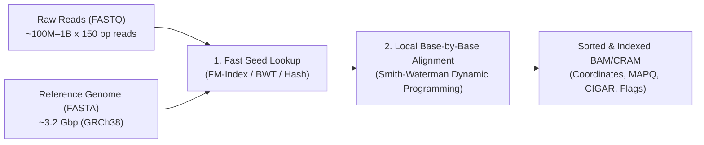

# Week 4: DNA Alignment Fundamentals — Core Concepts & Visualizations

**Course:** Applied Bioinformatics for Genomics (BFX Workshop 2025–2026)  
**Instructor:** Chris Miller, Ph.D.  
**Transcription Model:** Whisper `large-v3-turbo` (`week_04_lecture.txt` / `week_04_lecture.srt`)

---

## 1. Why Sequence Alignment Is Challenging

After generating raw sequencing reads (`FASTQ`) and checking quality (`FastQC`), the foundational step of genomic analyses is **mapping and aligning reads to a reference genome**.

- **Genome Size & Volume:** The human reference genome is **~3.2 Gbp**, and a sequencing run yields **$10^8$–$10^9$ short reads** ($2 \times 150\text{ bp}$).
- **Repetitive DNA (>50% of the human genome):** Telomeric hexamer repeats `(TTAGGG)n`, *Alu* elements (~300 bp, ~10% of the human genome), and LINEs cause ambiguous multi-mapping.
- **Errors vs. True Variants:** Aligners must distinguish base-calling errors from true SNPs, indels, and structural variants.



---

## 2. Two-Step Alignment Architecture: Seed-and-Extend

### Stage 1: Global Indexing & Seeding (`bwa index`)
- **Hash Tables / $k$-mers** and the **Burrows-Wheeler Transform (BWT) / FM-Index** compress the 3.2 Gbp human genome into a **~3–4 GB index** in RAM, enabling rapid lookup of Super-Maximal Exact Matches (**SMEMs**) to identify candidate loci.

### Stage 2: Local Alignment via Smith-Waterman Dynamic Programming
Once candidate loci are seeded, base-by-base **Smith-Waterman local alignment** resolves mismatches, insertions (`I`), deletions (`D`), and **soft-clipped (`S`)** read overhangs using a match/mismatch matrix and **affine gap penalties** ($\text{Penalty} = O + L \times E$):

```
Reference:  A  T  G  C  A  T  G  G  C  A  G  C  T
Read:       A  T  G  C  -  T  G  T  C  A  a  g  t
            |  |  |  |     |  |  .  |  |  ~~~~~~~
Operation:  M  M  M  M  D  M  M  M  M  M  3S (Soft-clipped adapter/overhang)
CIGAR: 4M1D5M3S
```

---

## 3. Mapping Quality (`MAPQ`) vs. Base Quality ($Q$)

$$\text{MAPQ} = -10 \log_{10} P(\text{read is mapped to the wrong genomic coordinate})$$

| Metric | Source | What It Measures | Example Value |
| :--- | :--- | :--- | :--- |
| **Base Quality ($Q$)** | Sequencer (`FASTQ` line 4) | Probability that an individual nucleotide call (`A/C/G/T`) is wrong | `Q30` = 99.9% accurate base call |
| **Mapping Quality (`MAPQ`)** | Aligner (`SAM` col 5) | Probability that the **entire read** is placed at the wrong genomic locus | `MAPQ 60` = uniquely mapped; `MAPQ 0` = multi-mapped equally to $\ge 2$ repeat loci |

---

## 4. SAM / BAM / CRAM Architecture & Bitwise Flags

| Format | Description | Typical 30x WGS Size | Random Access? |
| :--- | :--- | :--- | :--- |
| **SAM** (`.sam`) | Human-readable tab-delimited text (`@HD`, `@SQ`, `@RG`, `@PG` headers + 11 columns) | ~400–500 GB | No |
| **BAM** (`.bam` + `.bai`) | BGZF block-compressed binary SAM | ~80–100 GB | **Yes** (via `.bai` index) |
| **CRAM** (`.cram` + `.crai`) | Reference-based differential compression | ~40–50 GB | **Yes** (requires reference FASTA) |

### 11 Mandatory SAM Columns & Bitwise Flags (`FLAG`)

```
QNAME     FLAG  RNAME  POS    MAPQ  CIGAR  RNEXT  PNEXT  TLEN  SEQ      QUAL     TAGS
read_001  99    chr17  41245  60    100M   =      41520  375   ACTG...  FFFF...  NM:i:0 RG:Z:2895499331
```

```
Bit   Dec    Hex     Meaning
───   ────   ─────   ──────────────────────────────────────────────────
2^0      1   0x001   Read is paired in sequencing
2^1      2   0x002   Read is mapped in a proper pair
2^2      4   0x004   Read itself is unmapped
2^3      8   0x008   Mate is unmapped
2^4     16   0x010   Read mapped to reverse strand (-)
2^5     32   0x020   Mate mapped to reverse strand (-)
2^6     64   0x040   Read is First in pair (Read 1)
2^7    128   0x080   Read is Second in pair (Read 2)
2^8    256   0x100   Not primary alignment (secondary)
2^9    512   0x200   Fails platform/vendor quality checks
2^10  1024   0x400   PCR or optical duplicate
2^11  2048   0x800   Supplementary alignment (chimeric/split read)
```
- **Example (`FLAG = 99`):** $64\text{ (Read 1)} + 32\text{ (Mate reverse)} + 2\text{ (Proper pair)} + 1\text{ (Paired)} = 99$.

---

## 5. Production Streaming Pipeline (`Picard` → `BWA-MEM` → `Samtools` → `IGV`)

```bash
set -o pipefail
set -o errexit

# Stream unaligned BAM -> interleaved FASTQ -> BWA-MEM with @RG -> compressed BAM
java -Xms2G -jar /usr/gitc/picard.jar SamToFastq \
  INPUT=unaligned/normal/2895499399.bam FASTQ=/dev/stdout INTERLEAVE=true NON_PF=true \
  | /usr/gitc/bwa mem -R "@RG\tID:2895499399\tPL:ILLUMINA\tPU:H7HY2CCXX.4\tLB:lib1\tSM:HCC1395_BL\tCN:MGI" \
    -p ref/hla_and_brca_genes.fa /dev/stdin \
  | /usr/local/bin/samtools view -1 -o aligned/normal/2895499399.bam -

# Merge read-group BAMs and index for random access in IGV
java -Xms2G -jar /usr/gitc/picard.jar MergeSamFiles \
  OUTPUT=aligned/normal.bam INPUT=aligned/normal/2895499331.bam INPUT=aligned/normal/2895499399.bam
samtools index aligned/normal.bam
```
