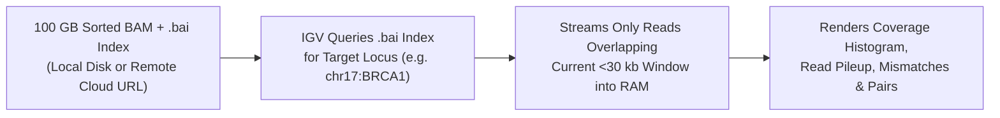

# Week 5: Sequence Data Visualization & IGV — Core Concepts & Visualizations

**Course:** Applied Bioinformatics for Genomics (BFX Workshop 2025–2026)  
**Instructor:** Chris Miller, Ph.D.  
**Transcription Model:** Whisper `large-v3-turbo` (`week_05_lecture.txt` / `week_05_lecture.srt`)

---

## 1. Why Desktop Visualization with IGV?

After aligning reads into a sorted, indexed `BAM` file, inspecting alignments visually is essential before trusting automated variant callers. Among >40 genome browsers (UCSC, Ensembl, Savant, Trackster/Galaxy), **IGV (Integrative Genomics Viewer)** is the gold standard for high-throughput sequencing read inspection because:
1. **Data Privacy (HIPAA / Patient Genomes):** Runs locally on your desktop without uploading sensitive patient `BAM` files to third-party web servers.
2. **Scalability via `.bai` Index Slice Loading:** A 100 GB `BAM` file cannot fit in laptop RAM, but IGV uses the companion `.bam.bai` index to fetch only the kilobase window currently in view (local disk or remote HTTP/cloud URL).
3. **Multi-Modal Integration:** Displays WGS/Exome `BAM`s, `RNA-seq` splice junctions, `BigWig` ChIP-seq signal tracks, and `VCF`/`BED` annotations simultaneously.



---

## 2. Evaluating SNVs and Indels vs. Artifacts in IGV

When zooming inside the `<30 kb` visibility threshold, matching bases are rendered in gray while **mismatches against the reference genome are highlighted by nucleotide color** (`A`=Green, `C`=Blue, `G`=Brown/Orange, `T`=Red) with color alpha scaled by **base quality ($Q$)**.

```
Reference:  ... G  A  T  T  A  C  A  G  G  C  T ...
Coverage:      [███████████▄███████████████████]
Read 1 (+):     .  .  .  .  C  .  .  .  .  .  .   (High base quality, forward strand)
Read 2 (-):     .  .  .  .  C  .  .  .  .  .  .   (High base quality, reverse strand)
Read 3 (+):     .  .  .  .  .  .  .  .  .  .  .   (Reference allele)
Read 4 (-):     .  .  .  .  C  .  .  .  .  .  .   (VAF ~ 50% heterozygous SNV)
```

### Checklist for Validating a Small Variant (SNV / Indel)
| Diagnostic Feature | High-Confidence True Variant | Common Sequencing / Mapping Artifact |
| :--- | :--- | :--- |
| **Coverage & Allele Support** | Sufficient depth ($\ge 20\times$) with expected VAF (~50% or 100% germline) | Only 1–2 supporting reads or extreme coverage spike (collapsed repeat) |
| **Strand Balance** | Variant supported on **both** forward (pink) and reverse (blue) reads | **100% strand bias** (all variant reads on one strand $\rightarrow$ PCR/sequencing error) |
| **Base Quality ($Q$)** | Bright, solid nucleotide letter (`Q30+`) in middle of read | Faint/transparent base at noisy $3'$ read ends |
| **Mapping Quality (`MAPQ`)** | Solid gray read body (`MAPQ = 60`) | Hollow/white/translucent read body (`MAPQ = 0` multi-mapped paralog) |
| **Neighborhood Cleanliness** | Clean flanking sequence | Dense "confetti" of phased mismatches across reads (misaligned paralog or unaligned indel) |

---

## 3. Detecting Structural Variants (SVs) via Inferred Insert Size & Pair Orientation

Paired-end Illumina reads are sequenced from the two ends of a size-selected DNA fragment (e.g., expected insert size $\mu \approx 400\text{ bp}$), naturally aligning in **inward-facing (`F1R2` / `--> <--`)** orientation. When the subject genome carries a structural rearrangement relative to the reference, mapping the read pair back to the reference alters the **inferred insert size (`TLEN`)** and/or **read-pair orientation**:

### A. Deletion vs. Insertion (Color by Insert Size)
```
DELETION IN SUBJECT GENOME:
Subject DNA:     5' ════[Read 1 ──►]════(Deleted Segment Missing)════[◄── Read 2]════ 3'
                        |<─────────── True Fragment = 400 bp ──────────>|

Mapped to Ref:   5' ════[Read 1 ──►]════[2,000 bp Reference Segment]═[◄── Read 2]════ 3'
                        |<─────── Inferred Insert Size = 2,400 bp (RED) ───────>|
                 Result in IGV: Sharp drop in coverage + RED read pairs (inferred insert >> expected)
```

| SV Event | Effect on Inferred Insert Size (`TLEN`) | IGV Color (Color by Insert Size) | Coverage Signature |
| :--- | :--- | :--- | :--- |
| **Deletion** | **Larger** than expected ($\text{TLEN} \gg \mu$) | **Red** | Coverage drops (50% het / 0% hom) between flanking pairs |
| **Insertion** | **Smaller** than expected ($\text{TLEN} \ll \mu$) | **Blue** | Soft-clipped reads (`S`) piling up at insertion breakpoint |
| **Inter-chromosomal Translocation** | Undefined (mates map to different chromosomes, e.g., `chr1` and `chr6`) | Colored by **mate chromosome** | Split-read soft-clips at fusion breakpoint |

### B. Inversion & Tandem Duplication (Color by Pair Orientation)
```
INVERSION OF SEGMENT [A ──► B] IN SUBJECT GENOME:
Subject DNA:     5' ════[Read 1 ──►]══[◄── B' ─── A' ──]═══ 3'   (Read 2 crosses into inverted segment)
Mapped to Ref:   5' ════[Read 1 ──►]══[──► A ──── B ──►]═══ 3'   (Read 2 flips to SAME strand as Read 1!)
                        [Read 1 ──►]      [Read 2 ──►]           --> Same-strand pair (--> --> or <-- <--)
```

- **Left breakpoint of Inversion:** Forward-forward (`--> -->`) read pairs (**Teal / Cyan** in IGV).
- **Right breakpoint of Inversion:** Reverse-reverse (`<-- <--`) read pairs (**Blue** in IGV), accompanied by a sharp dip in coverage right at the breakpoint where unsplit reads fail to align cleanly.
- **Tandem Duplication:** Outward-facing (`<-- -->`, `R1F2`) read pairs (**Green** in IGV) + $1.5\times$/$2\times$ elevated coverage across the duplicated interval.
