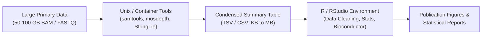

# Week 6: Data Manipulation & Basic Plotting with R — Core Concepts & Visualizations

**Course:** Applied Bioinformatics for Genomics (BFX Workshop 2025–2026)  
**Instructor:** Chris Miller, Ph.D.  
**Transcription Model:** Whisper `large-v3-turbo` (`week_06_lecture.txt` / `week_06_lecture.srt`)

---

## 1. Role of R in the Genomics Analysis Pipeline

While primary sequence processing (`FASTQ` QC, `BWA`/`HISAT2` alignment, `GATK` variant calling) runs on compiled Unix command-line tools, **R** is the premier environment for **secondary and tertiary analysis**—statistical modeling, tabular data munging, Bioconductor genomics packages (`DESeq2`, `Ballgown`, `Seurat`), and publication-quality graphics (`ggplot2`).

> **The Bioinformatics Paradigm:** Use fast Unix/C++ tools (e.g., `mosdepth`, `samtools`, `StringTie`) to condense gigabyte `BAM` files into bite-sized summary tables (`TSV`/`CSV`), then import those tables into **R / RStudio** for exploration, hypothesis testing, and visualization.



---

## 2. Vectors, 1-Based Indexing & Vectorized Operations

Unlike Python or C (which use 0-based indexing) and BED coordinates, **R uses 1-based indexing**, where the first element of a vector is at index `[1]`.

```
Vector:   n = c(3,  7,  12,  50,  103)
Index:         [1] [2]  [3]  [4]  [5]
```

| Expression | Result | Explanation |
| :--- | :--- | :--- |
| `n <- c(3, 7, 12, 50, 103)` | `3 7 12 50 103` | `c()` combines values into a homogeneous atomic vector |
| `n[4]` | `50` | Extracts the 4th element (1-based) |
| `n[-2]` | `3 12 50 103` | Negative index **excludes** the 2nd element |
| `n[1:3]` | `3 7 12` | Inclusive slice from index 1 through 3 |
| `n[c(1, 3, 5)]` | `3 12 103` | Subsets non-contiguous indices using a vector |
| `n[n < 50]` | `3 7 12` | Logical filtering (returns elements where `n < 50` is `TRUE`) |
| `n[n > 8 & n != 50]` | `12 103` | Compound boolean filtering (`&` = AND, `\|` = OR, `!=` = not equal) |
| `n + 1` | `4 8 13 51 104` | **Vectorized arithmetic:** adds 1 to every element without a loop |
| `mean(n)`, `var(n)`, `sum(n)` | `35`, `1796.5`, `175` | Built-in summary statistics (`min(n)`, `max(n)`) |

---

## 3. Data Frames (`data.frame`) & Matrix Subsetting

A **`data.frame`** is a 2D table where **each column is a vector of a single data type** (`numeric`, `character`, `logical`, `Date`), while different columns can hold different types. Subsetting follows the **`df[rows, columns]`** convention:

```
                   Columns (Variables / Features)
               ┌────────────┬────────────────┬─────────────┐
               │ clostridia │ proteobacteria │ bacteroides │
┌──────────────┼────────────┼────────────────┼─────────────┤
│ 01_healthy   │     22     │       54       │     245     │  <-- Row 1
│ 02_healthy   │     26     │       65       │     265     │  <-- Row 2
│ 03_healthy   │     34     │       66       │     262     │  <-- Row 3
│ 01_sick      │     32     │       32       │     116     │  <-- Row 4
│ 02_sick      │     12     │       24       │     101     │  <-- Row 5
│ 03_sick      │      9     │       18       │      87     │  <-- Row 6
└──────────────┴────────────┴────────────────┴─────────────┘
```

```r
# Read CSV table with sample names in column 1
bac <- read.csv("https://is.gd/bacteriacsv", row.names = 1)

# Subset rows and columns: df[row_selector, col_selector]
bac[-1, -2]                          # Drop row 1 (01_healthy) and column 2 (proteobacteria)
bac$proteobacteria                   # Extract column as vector: 54 65 66 32 24 18

# Two-sample t-test comparing healthy (rows 1:3) vs sick (rows 4:6)
t.test(bac$proteobacteria[1:3], bac$proteobacteria[4:6])   # p-value = 0.002725

# Export as clean tab-separated file without quotes around strings
write.table(bac, file = "bacteria_clean.tsv", sep = "\t", quote = FALSE, col.names = NA)
```

---

## 4. Base R Exploratory Visualization & Data Munging

### A. Base R Graphics (`barplot`, `boxplot`, `hist`, `plot`)
Skewed biological count data often spans orders of magnitude; applying $\log_{10}(y)$ or $\sqrt{y}$ transformations reveals underlying structure:

```r
y <- c(1,1,2,3,3,4,4,5,10,11,11,14,15,16,16,16,20,32)
boxplot(y, log10(y), sqrt(y), names = c("Raw", "log10", "sqrt"))
hist(log(y), col = "salmon", main = "Log-Transformed Distribution")
```

### B. Data Cleaning & Type Conversion (Homework Exercise)
Real-world spreadsheets contain typos, inconsistent case (`"male"`, `"Male"`, `"M"`), compound columns (`"Site1_PlotA"`), and character dates (`"03-15-2017"`) that sort alphabetically unless converted to `Date` objects:

```r
# 1. Inspect data structure and column classes
str(fundData)
summary(fundData)

# 2. Split a compound column ("Site_Plot") into two separate columns using tidyr::separate
library(tidyr)
fundData <- separate(fundData, col = Site_Plot, into = c("Site", "Plot"), sep = "_")

# 3. Convert character strings ("MM-DD-YYYY") into proper chronological Date objects
fundData$Date <- as.Date(fundData$Date, format = "%m-%d-%Y")
```
