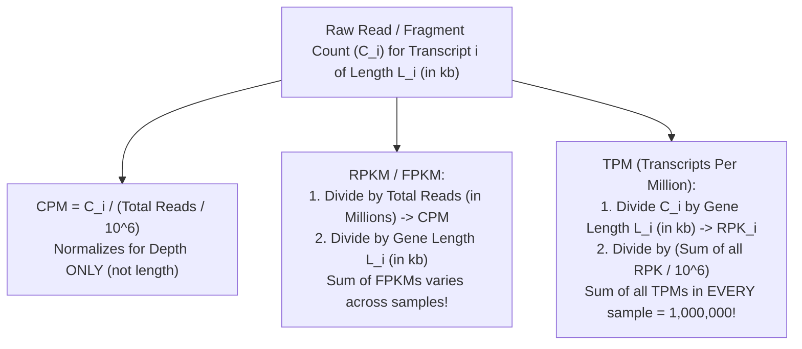
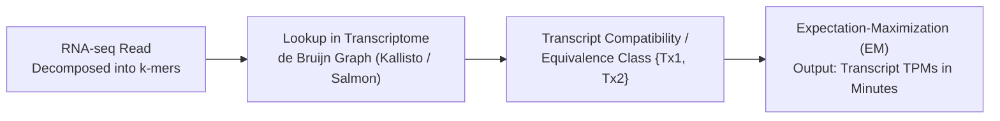

# Week 8: RNA-seq Part 2 — Transcript Quantification & Abundance Estimation

**Course:** Applied Bioinformatics for Genomics (BFX Workshop 2025–2026)  
**Instructor:** Chris Miller, Ph.D.  
**Transcription Model:** Whisper `large-v3-turbo` (`week_08_lecture.txt` / `week_08_lecture.srt`)

---

## 1. Genes vs. Transcripts & Why Raw Counts Are Biased

When sequencing RNA, reads originate from **mature mRNA transcripts (isoforms)** rather than abstract "genes." A single gene locus often produces multiple isoforms via alternative promoters, exon skipping, or alternative polyadenylation.

```
Gene X Locus:   ──[Exon 1]══════[Exon 2]══════[Exon 3]══════[Exon 4]──
Isoform A:        [Exon 1]──────[Exon 2]──────[Exon 3]──────[Exon 4]   (Full length: 2.0 kb)
Isoform B:        [Exon 1]────────────────────[Exon 3]──────[Exon 4]   (Exon 2 skipped: 1.2 kb)
```

### Two Fundamental Biases in Raw RNA-seq Read Counts
1. **Sequencing Depth (Library Size) Bias:** A sample sequenced to 100 million reads will yield $5\times$ more raw counts for an identically expressed gene than a sample sequenced to 20 million reads.
2. **Transcript Length Bias:** Within the same sample, a $4\text{ kb}$ transcript produces $4\times$ as many random $150\text{ bp}$ fragments per molecule as a $1\text{ kb}$ transcript expressed at the exact same molar concentration.

```
SEQUENCING DEPTH BIAS (Same Gene, 2 Samples):      GENE LENGTH BIAS (2 Genes, Same Sample):
Sample 1 (1M reads):  [Gene A: 2 reads]            Gene A (1 kb): [████]        -> 2 reads
Sample 2 (2M reads):  [Gene A: 4 reads]            Gene B (2 kb): [████████]    -> 4 reads
Normalized (CPM):     Both = 2.0 CPM               Normalized (FPKM/TPM): Both = equal abundance
```

---

## 2. RNA-seq Abundance Metrics: CPM, RPKM, FPKM, and TPM

The key difference between **FPKM** and **TPM (Transcripts Per Million)** is the **order of operations**:



$$\text{FPKM}_i = \frac{C_i}{\left(\frac{\sum_j C_j}{10^6}\right) \cdot L_i(\text{kb})}, \qquad \text{TPM}_i = \frac{C_i / L_i(\text{kb})}{\sum_j \left(C_j / L_j(\text{kb})\right)} \times 10^6$$

| Metric | Accounts for Depth? | Accounts for Gene Length? | Constant Sum Across Samples? | Best Use Case |
| :--- | :---: | :---: | :---: | :--- |
| **Raw Counts** (`htseq-count`) | No | No | No | Input to count-based DE models (`DESeq2`, `edgeR`) |
| **CPM** (Counts Per Million) | Yes | No | Yes ($10^6$) | Comparing the same gene across samples without length normalization |
| **RPKM / FPKM** | Yes (1st) | Yes (2nd) | **No** | Legacy within-sample comparisons (`StringTie` / `Cufflinks`) |
| **TPM** (Transcripts Per Million) | Yes (2nd) | Yes (1st) | **Yes ($10^6$)** | **Gold standard** for comparing relative abundance within & across samples |

---

## 3. Alignment-Based Quantification: `htseq-count` vs. `StringTie`

### A. Raw Gene Counting with `htseq-count`
`htseq-count` counts only **uniquely mapped reads** overlapping annotated exons and provides three overlap resolution modes (`-m`):
```
1. union (default):         2. intersection-strict:      3. intersection-nonempty:
Read overlapping Gene A     Read must fall 100% inside   Read overlapping Gene A + intergenic
only -> counted for Gene A. exon; overhang -> no_feature. space -> counted for Gene A.
Read overlapping BOTH Gene A and Gene B simultaneously -> marked "ambiguous" in all 3 modes!
```

### B. Splice-Graph Isoform Assembly & Quantification with `StringTie`
1. **Splice Graph Construction:** Groups spliced alignments (`HISAT2` `BAM`) into a directed acyclic graph of exons and splice junctions.
2. **Maximum Flow Optimization:** Iteratively extracts the heaviest isoform path and estimates transcript-level coverage, `FPKM`, and `TPM`.
3. **Operating Modes:**
   - **Reference-only (`stringtie -G ref.gtf -e -B`):** Quantifies only known reference transcripts and outputs `.ctab` tables (`e_data.ctab`, `i_data.ctab`, `t_data.ctab`) for **Ballgown** differential expression.
   - **Guided de novo (`stringtie -G ref.gtf`):** Quantifies known transcripts and assembles novel isoforms (`stringtie --merge` unifies GTFs across cohorts).

---

## 4. Alignment-Free Pseudoalignment (`Kallisto` & `Salmon`)

Instead of base-by-base genomic alignment, **pseudoaligners** (`Kallisto`, `Salmon`, `Sailfish`) index the **reference transcriptome** into a **$k$-mer de Bruijn graph** and determine which transcripts are compatible with the $k$-mers of each read (**equivalence classes**), resolving multi-mapping via **Expectation-Maximization (EM)**.



| Feature | Spliced Genome Aligner (`HISAT2` + `StringTie`) | Pseudoaligner (`Kallisto` / `Salmon`) |
| :--- | :--- | :--- |
| **Reference Required** | Genome FASTA + Annotation GTF | Reference Transcriptome FASTA only |
| **Speed & Memory** | Slower (~hours), higher disk/CPU | **Extremely fast** (~minutes on a laptop) |
| **Outputs Coordinate `BAM`?** | **Yes** (viewable in IGV; supports SNV/fusion/novel exon discovery) | **No** (cannot discover unannotated splicing or genomic variants) |
