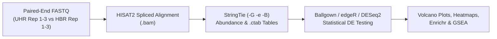

# Week 9: RNA-seq Part 3 — Differential Expression & Pathway Analysis

**Course:** Applied Bioinformatics for Genomics (BFX Workshop 2025–2026)  
**Instructor:** Chris Miller, Ph.D.  
**Transcription Model:** Whisper `large-v3-turbo` (`week_09_lecture.txt` / `week_09_lecture.srt`)

---

## 1. End-to-End Tuxedo2 RNA-seq Pipeline (`HISAT2` → `StringTie` → `Ballgown`)

In the third part of the RNA-seq series, transcript and gene abundances estimated by `StringTie` (or raw counts from `htseq-count`) are statistically compared across experimental groups (e.g., **UHR** Universal Human Reference vs. **HBR** Human Brain Reference) to identify **Differentially Expressed Genes (DEGs)** and **Differential Transcript Usage (alternative splicing)**.



---

## 2. ERCC Spike-In Controls & Quality Validation

The tutorial dataset spikes **ERCC (External RNA Controls Consortium) ExFold Mix 1 and Mix 2** into the UHR and HBR replicates:
- **92 synthetic poly(A) transcripts** present at known molar concentrations and known Mix1:Mix2 fold-change ratios ($4:1$, $1:1$, $1:1.5$, $1:2$).
- **Three Core Uses:**
  1. **Normalization:** Calibrates for technical variation in RNA input, reverse transcription efficiency, and sequencing depth.
  2. **Fold-Change Validation:** Compares observed RNA-seq fold changes against ground-truth expected ratios.
  3. **Outlier Sample Detection:** Flags failed libraries if ERCC curves deviate sharply in one replicate.

---

## 3. Statistical Modeling for Differential Expression & Multiple Testing

### A. Parametric Linear Modeling in `Ballgown` (`stattest`)
`Ballgown` loads the `.ctab` directory hierarchy produced by `StringTie -B` and fits **nested linear models** to each transcript or gene using `FPKM` (or `TPM`) as the outcome:
- **Null Model ($M_0$):** Expression modeled using only nuisance covariates (e.g., batch, library prep).
- **Full Model ($M_1$):** Expression modeled using nuisance covariates **plus** the group covariate of interest (`covariate="type"`, e.g., UHR vs. HBR).
- A **parametric $F$-test** compares $M_1$ vs. $M_0$. Count-based tools (**`DESeq2`**, **`edgeR`**) instead model raw integer counts directly using a **Negative Binomial generalized linear model (GLM)** to account for mean-dependent **overdispersion** ($\text{Var} > \text{Mean}$).

```r
library(ballgown)
bg <- ballgown(dataDir="ballgown/ref_only", samplePattern="Rep", pData=pheno_data)
bg_filt <- subset(bg, "rowVars(texpr(bg)) > 1", genomesubset=TRUE) # Filter low-variance genes

results_transcripts <- stattest(bg_filt, feature="transcript", covariate="type", getFC=TRUE, meas="FPKM")
results_genes       <- stattest(bg_filt, feature="gene",       covariate="type", getFC=TRUE, meas="FPKM")
```

### B. Multiple Hypothesis Testing & False Discovery Rate (FDR / $q$-value)
Testing $20,000$ genes at an unadjusted threshold of $\alpha = 0.05$ produces:
$$20,000 \times 0.05 = 1,000 \text{ false-positive genes by random chance alone!}$$
- **Bonferroni Correction ($p_{\text{adj}} = p \times N$):** Controls Family-Wise Error Rate (FWER) but is overly conservative for genomics, causing massive false negatives.
- **Benjamini-Hochberg False Discovery Rate (FDR / $q$-value):** Ranks all $p$-values and controls the expected **proportion** of false positives among called hits (e.g., $q < 0.05$ means $\le 5\%$ of reported DEGs are expected to be false discoveries). Filter low-expression/zero-variance genes *before* testing to reduce the multiple-testing penalty.

---

## 4. Visualizing Differential Expression: Volcano Plots & Heatmaps

```
                      VOLCANO PLOT: -log10(p-value) vs log2(Fold Change)
        -log10(p)
           6 |    *  *  (Downregulated in UHR)     |     (Upregulated in UHR)  *  *
           4 |      *  *                           |                         *   *
           2 | - - - - - - - - - - - - - - - - - - + - - - - - - - - - - - - - - - - -  p = 0.01
           0 |____________________. . . . .________|________. . . . ._________________
            -6          -2 (LFC <= -2)             0             +2 (LFC >= +2)      +6
                                        log2(Fold Change)
```

- **Volcano Plot:** Plots **effect size** ($\log_2 \text{Fold Change}$ on the $x$-axis, symmetric around $0$) against **statistical significance** ($-\log_{10} p\text{-value}$ on the $y$-axis). Genes in the upper-left and upper-right quadrants have both large biological magnitude ($|\log_2 \text{FC}| \ge 2$) and high statistical confidence ($p < 0.01$).
- **Hierarchical Clustering Heatmaps (`pheatmap`):** Clusters both genes (rows) and samples (columns); biological replicates of the same condition should always cluster together.

---

## 5. Downstream Interpretation: Over-Representation (`Enrichr`) vs. `GSEA`

| Method | Input Required | Key Pitfall / Best Practice |
| :--- | :--- | :--- |
| **Over-Representation (`Enrichr`, GO, KEGG)** | Hard threshold list of significant DEGs (e.g., $q < 0.05$) | **Always supply a custom background gene list** (all genes detected in your assay), otherwise tissue-specific expression inflates false pathway hits! |
| **Gene Set Enrichment Analysis (`GSEA` / `MSigDB`)** | **All** expressed genes ranked continuously from most upregulated to most downregulated | Detects coordinated, subtle shifts across an entire pathway without an arbitrary $p$-value cutoff. |
