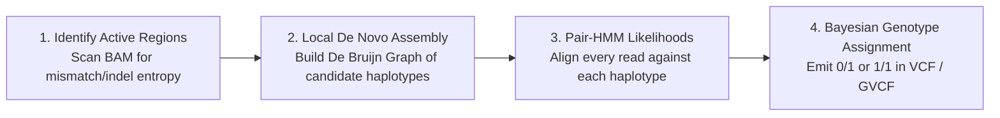

# Week 10: Germline & Somatic Variant Calling — Core Concepts & Visualizations

**Course:** Applied Bioinformatics for Genomics (BFX Workshop 2025–2026)  
**Instructor:** Chris Miller, Ph.D.  
**Transcription Model:** Whisper `large-v3-turbo` (`week_10_lecture.txt` / `week_10_lecture.srt`)

---

## 1. Challenges of Small Variant Calling (SNVs & Indels)

Detecting single-nucleotide variants (**SNVs**) and small insertions/deletions (**Indels**, $<30\text{ bp}$) across the $3.2 \times 10^9\text{ bp}$ human genome requires an exceedingly low False Discovery Rate (**FDR**):
- Even an FDR of $0.001$ ($99.9\%$ specificity) across $3.2 \times 10^9\text{ bp}$ yields **$3.2\text{ million false positives}$**!
- **Key Confounders:**
  1. **PCR Duplicates & "Jackpotting":** Low input DNA or excessive PCR cycles amplify a single molecule into dozens of identical read pairs sharing the exact same start/end coordinates (`Picard MarkDuplicates` flags these as SAM bit `1024`).
  2. **Paralogous Multi-Mapping:** Pseudogenes or segmental duplications align back to the canonical gene locus with pileups of phased "variants."
  3. **Indel Alignment Ambiguity:** Aligners evaluate each read independently (`BWA`), often placing gap penalties as terminal mismatches at the ends of reads rather than opening a consistent indel gap.

```
UNREALIGNED INDEL PILEUP (Per-Read Independent Mapping):     AFTER LOCAL DE NOVO REASSEMBLY (HaplotypeCaller):
Ref:   A T G C T G A C T G A C T G                           Ref:   A T G C T G A C T G A C T G
Read1: A T G C - - - C T G A C T G  (3 bp del called)        Read1: A T G C - - - C T G A C T G
Read2: A T G C c t g a c t g        (Misaligned as SNVs!)    Read2: A T G C - - - C T G A C T G
Read3:         t g a C T G A C T G  (Misaligned as SNVs!)    Read3:         - - - C T G A C T G
```

---

## 2. Germline Variant Calling with `GATK HaplotypeCaller` & VCF Format

Germline callers assume a **diploid genome** where true genotypes fall into three discrete states: **Homozygous Reference (`0/0`, ~0% VAF)**, **Heterozygous (`0/1`, ~50% VAF)**, or **Homozygous Alternate (`1/1`, ~100% VAF)**.



### Anatomy of a VCF (Variant Call Format) Record
```
#CHROM  POS      ID          REF  ALT  QUAL    FILTER  INFO             FORMAT          NORMAL_SAMPLE
chr17   7674894  rs1042522   G    C    1420.7  PASS    DP=52;AF=0.50    GT:AD:DP:GQ:PL  0/1:26,26:52:99:1450,0,1420
```
- **`GT` (Genotype):** `0/1` (unphased het), `1/1` (hom alt), or `0|1` (**phased** via read-backed phasing or trio pedigree inheritance).
- **`AD` & `DP`:** Allelic depths (`26` ref reads, `26` alt reads) and total filtered depth (`52`).
- **`GQ` & `PL`:** Genotype Quality (`99` max confidence) and Phred-scaled genotype likelihoods for `0/0`, `0/1`, `1/1` (`0` = most likely state).

---

## 3. Somatic Variant Calling in Cancer (`Mutect2` & `VarScan2`)

In cancer genomics, we sequence **both a Tumor sample and a Matched Normal sample** from the same patient (`2x` cost) to subtract the patient's ~3 million inherited germline SNPs and isolate true **somatic mutations**.

### Why Somatic Calling Violates Diploid `0/50/100%` VAF Assumptions
1. **Tumor Purity (Normal Cell Contamination):** If a biopsy is 50% tumor cells and 50% normal stroma/immune cells, a heterozygous clonal somatic mutation has an observed $\text{VAF} = 50\% \times 0.5 = \mathbf{25\%}$ ($5/20$ reads).
2. **Copy Number / Ploidy Alterations (CNVs / LOH):** Trisomy ($3$ copies) shifts VAFs to **$33\%$ (`AAB`) or $66\%$ (`ABB`)**; Loss of Heterozygosity ($1$ copy) shifts VAF to **$100\%$**.
3. **Subclonal Tumor Evolution:** Subclones emerging late in tumor evolution may be present in only 10% of tumor cells ($\text{VAF} \approx 2\text{--}5\%$).

```
HOW PURITY, PLOIDY & CLONALITY SHIFT SOMATIC VAF:
• Pure Diploid Clonal Het (2 copies, 100% purity):    [Ref][Alt]                ──► VAF = 50%
• 50% Tumor Purity + 50% Normal Cells (Diploid):      [Ref][Alt] + [Ref][Ref]   ──► VAF = 25% (5/20 reads)
• Copy Number Gain (3 copies in tumor):               [Ref][Ref][Alt]           ──► VAF = 33% (or 66% if 2 Alt)
• Subclonal Mutation (present in 20% of tumor cells):                           ──► VAF = 5% - 10%
```

### Multi-Caller Ensemble Strategy (`Mutect2` + `VarScan` + `CombineVariants`)
```bash
# 1. Germline calling on Normal BAM with GATK4 HaplotypeCaller
/gatk/gatk HaplotypeCaller --input /data/inputs/normal.bam --output /data/germline.vcf.gz --reference /data/inputs/chr17.fa

# 2. Somatic calling on Tumor/Normal pair with GATK4 Mutect2
/gatk/gatk Mutect2 --java-options "-Xmx4g" -O /data/mutect.vcf.gz -R /data/inputs/chr17.fa \
  -I /data/inputs/tumor.bam -tumor "Exome_Tumor" -I /data/inputs/normal.bam -normal "Exome_Normal"

# 3. Somatic calling with VarScan2 via samtools mpileup process substitution
java -jar /opt/varscan/VarScan.jar somatic \
  <(/opt/samtools/bin/samtools mpileup --no-baq -f /data/inputs/chr17.fa /data/inputs/normal.bam /data/inputs/tumor.bam) \
  /data/varscan.vcf --strand-filter 0 --min-coverage 8 --min-var-freq 0.1 --p-value 0.99 --mpileup 1 --output-vcf

# 4. Merge and prioritize callers using GATK CombineVariants
java -Xmx2g -jar /opt/GenomeAnalysisTK.jar -T CombineVariants -genotypeMergeOptions PRIORITIZE \
  --rod_priority_list mutect,varscan -o /data/combined.vcf.gz -R /data/inputs/chr17.fa \
  --variant:mutect /data/mutect.filtered.vcf.gz --variant:varscan /data/varscan_merged.vcf.gz
```
