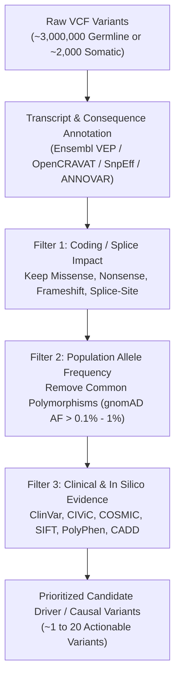

# Week 11: Variant Annotation & Prioritization — Core Concepts & Visualizations

**Course:** Applied Bioinformatics for Genomics (BFX Workshop 2025–2026)  
**Instructor:** Chris Miller, Ph.D.  
**Transcription Model:** Whisper `large-v3-turbo` (`week_11_lecture.txt` / `week_11_lecture.srt`)

---

## 1. Why Variant Annotation & Filtering Are Essential

A raw germline WGS `VCF` contains **~3 to 4 million variants**, and a cancer tumor/normal `VCF` contains **hundreds to thousands of somatic mutations**. Coordinates alone (`chr17:7674894 G>C`) do not tell us which variants alter protein function or drive disease. Variant annotation layers biological, population, and clinical context onto each VCF record to narrow millions of calls down to actionable candidates.



---

## 2. Layers of Variant Annotation

### A. Gene & Transcript Consequence (`Ensembl VEP`, `OpenCRAVAT`, `SnpEff`, `ANNOVAR`)
Because a single gene can have dozens of alternative splice isoforms, the exact same genomic base change can be **missense** in one transcript, **intronic** in another, and **$3'\text{-UTR}$** in a third.
- **Canonical / MANE Select Transcripts (`--pick` in VEP):** Selects the single most biologically conserved, well-supported transcript per gene (Matched Annotation from NCBI and EMBL-EBI) for reporting.

| Variant Consequence Class | Effect on Protein / mRNA | Typical Priority |
| :--- | :--- | :---: |
| **Loss-of-Function (`LoF`):** `stop_gained` (nonsense), `frameshift_variant`, `splice_acceptor`/`donor_variant` | Truncates protein, shifts reading frame, or abolishes splicing (often triggers nonsense-mediated decay) | **HIGH** |
| **Moderate Coding:** `missense_variant`, `inframe_insertion` / `inframe_deletion` | Substitutes an amino acid or adds/removes whole codons | **MODERATE** |
| **Low / Synonymous:** `synonymous_variant`, `splice_region_variant` | Silent codon change (occasionally disrupts exonic splicing enhancers) | **LOW** |
| **Modifier / Non-coding:** `intron_variant`, `upstream`/`downstream`, `intergenic` | Non-coding (may affect enhancers/TFBS in WGS, ignored in standard exome filtering) | **MODIFIER** |

### B. Population Databases (`gnomAD`, `1000 Genomes`, `dbSNP`)
- **gnomAD (Genome Aggregation Database):** Aggregates allele frequencies across hundreds of thousands of exomes and genomes across diverse ancestral populations.
- **Filtering Rule:** A variant present in **$>1\%$ (or $>0.1\%$) of the general population** is almost certainly a benign inherited polymorphism rather than a rare Mendelian disease mutation or an unsubtracted somatic driver.

### C. Clinical Knowledgebases & *In Silico* Pathogenicity Predictors
- **Clinical Databases:**
  - **ClinVar:** Germline variant pathogenicity assertions (`Pathogenic`, `Likely Pathogenic`, `VUS` Variant of Uncertain Significance, `Benign`) with star review ratings.
  - **CIViC (Clinical Interpretation of Variants in Cancer) & COSMIC:** Curated somatic cancer driver mutations, prognostic biomarkers, and targeted therapy sensitivities.
- **In Silico Damage Predictors:** **SIFT**, **PolyPhen-2**, **REVEL**, and **CADD** score amino acid conservation and structural disruption (useful supporting evidence, though prone to false positives if used alone).

---

## 3. HGVS Standardized Variant Nomenclature (`c.` vs. `p.`)

To prevent ambiguity across publications and clinical reports (e.g., loosely writing *"BRAF V600E"* without specifying genome build or isoform), the **Human Genome Variation Society (HGVS)** defines strict coordinate strings:

```
Transcript cDNA Notation:   ENST00000269305.9 : c.524G>A
                            └───────┬─────────┘ └────┬───┘
                          Ensembl Transcript ID   Coding DNA pos 524: G substituted by A

Protein Notation:           ENSP00000269305.4 : p.Arg175His  (or p.R175H)
                            └───────┬─────────┘ └─────┬─────┘
                            Ensembl Protein ID    Codon 175: Arginine (Arg) -> Histidine (His)
```

---

## 4. Hands-On Command-Line Filtering of VEP Output (`HCC1395` Somatic Variants)

```bash
# 1. Inspect VEP-annotated tab-delimited somatic calls (skip '##' metadata lines)
gunzip -c HCC1395.somatic.vep.tsv.gz | grep -v "^##" | less -S

# 2. Count total variant-transcript annotation lines vs unique variants (--pick)
gunzip -c HCC1395.somatic.vep.tsv.gz | grep -v "^#" | wc -l

# 3. Filter for coding consequences AND rare population frequency (gnomAD AF < 0.001 or empty "-")
gunzip -c HCC1395.somatic.vep.tsv.gz | grep -v "^#" \
  | awk -F"\t" '($36 == "-" || $36 < 0.001) && ($7 ~ /missense|stop_gained|frameshift|splice/)' \
  | cut -f 1,2,4,7,11,36 | head -n 20
```
