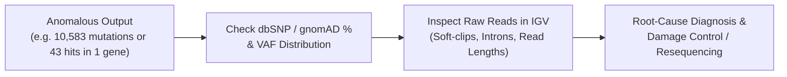

# Week 12: Troubleshooting Bioinformatics ("When Good Experiments Go Bad") — Core Concepts & Visualizations

**Course:** Applied Bioinformatics for Genomics (BFX Workshop 2025–2026)  
**Instructor:** Chris Miller, Ph.D.  
**Transcription Model:** Whisper `large-v3-turbo` (`week_12_lecture.txt` / `week_12_lecture.srt`)

---

## 1. Philosophy of Genomic Troubleshooting

> *"However improbable we regard this event, or any of the steps which it involves, given enough time it will almost certainly happen at least once."* — George Wald (Nobel Laureate)

In high-throughput genomics, wet-lab mistakes, sample mix-ups, cross-contaminations, and mismatched technical cohorts inevitably occur. Detecting them before publication requires **sanity checks on summary counts**, **population database cross-referencing (`dbSNP`/`gnomAD`)**, **VAF distribution inspection**, and **visual verification in IGV**.



---

## 2. Five Real-World Forensic Case Studies from Lecture

### Case #1: Glioblastoma Tumor/Normal Exome — The 10,583-Mutation Outlier
- **Symptom:** Two glioblastoma patients had `159` and `219` somatic mutations (`wc -l snvs.indels.annotated`), while a third patient had **`10,583` "somatic" mutations**.
- **Forensic Clues:**
  1. **~85%** of the 10,583 calls occurred at known **`dbSNP` population polymorphism sites**.
  2. Their Variant Allele Frequencies (**VAFs**) clustered cleanly around **50% (heterozygous) and 100% (homozygous)**.
- **Diagnosis: SAMPLE SWAP.** The tumor and normal BAMs came from **two different human individuals**; every germline SNP difference between the two unrelated people was called as a "somatic" mutation!
- **Damage Control:** Run SNP genotype concordance across all cohort BAMs (e.g., using `Somalier` or `Conpair`) to see if `S1_Tumor` matches `S2_Normal`, and verify with orthogonal data (RNA-seq, cytogenetics, sex chromosomes).

```
Normal Pair (Matched):     S1_Tumor vs S1_Normal  ──►    159 somatic mutations
Swapped Pair (Unmatched):  S1_Tumor vs S2_Normal  ──► 10,583 calls (~85% dbSNP @ 50%/100% VAF)
Re-paired Check:           S1_Tumor vs S2_Normal swapped back ──► ~200 true somatic mutations!
```

---

### Case #2: Cross-Sample Contamination in Multiplexed Exome Sequencing
- **Symptom:** Across 3 patients (`Normal`, `CML`, `AML` samples), the exact same set of mutations appeared in `Patient 1 CML` and `Patient 2 CML` at **13–16% VAF**, and those variants were known **`dbSNP` germline alleles of Patient 3**!
- **Diagnosis: CROSS-CONTAMINATION (~30% of Patient 3 DNA)** into the CML tubes during library preparation or liquid handling ($50\% \text{ heterozygous germline VAF} \times 30\% \text{ contamination} \approx 15\% \text{ observed VAF}$).
- **Damage Control:** Re-extract and re-sequence from original primary tissue vials; run contamination estimators (`GATK CalculateContamination` / `VerifyBamID`).

---

### Case #3: Mouse Tumor Exome — Mysterious Low Alignment Rate & High Soft-Clipping
- **Symptom:** A mouse tumor exome had a **30–40% lower mapping rate** than the rest of the cohort and massive soft-clipping in IGV.
- **Forensic Clue:** Taking unmapped reads and running **BLAST (`nt`)** against all known organisms revealed 100% identity to a **parasitic tapeworm / helminth** infecting the lab mouse colony (or *Mycoplasma* / viral / human contamination in cell culture)!
- **Diagnosis: FOREIGN SPECIES CONTAMINATION.**

---

### Case #4: 43 "Somatic Mutations" in a Single Gene (*DNMT3A*)
- **Symptom:** A tumor exome showed **43 somatic calls in *DNMT3A*** (1 canonical `p.R882H` missense mutation + **42 splice-site / splice-region mutations** at exact exon boundaries: `e21+4`, `e18+2`, `e18+1`, `e17-1`, etc.).
- **Forensic Clue in IGV:** Every read over *DNMT3A* terminated or soft-clipped sharply at exon-intron boundaries, with **zero coverage in introns**, while all other genes had normal intronic overhang coverage.

```
Normal Genomic DNA Read:   ───[Exon 17]══════(Intron 17)══════[Exon 18]───  (Aligns continuously to genome)
Contaminant cDNA Read:        [Exon 17][Exon 18]  ──(Aligned to Genome by BWA)──►
                           ───[Exon 17]s s s s s s            [Exon 18]───  (Overhangs into intron called as SNVs!)
```
- **Diagnosis: PCR AMPLICON / cDNA PLASMID CONTAMINATION.** Another bench in the same lab was amplifying cloned *DNMT3A* cDNA (which lacks introns!). Aerosolized cDNA contaminated the genomic DNA prep; because the DNA aligner (`BWA`) is not splice-aware, it forced the adjacent exon bases into the intronic reference sequence, generating false "splice-site" variant calls at every exon boundary!

---

### Case #5: Serial Relapse WGS — 10,114 Relapse-Specific Mutations
- **Symptom:** An AML primary tumor had `573` somatic mutations, but the relapse WGS sequenced 6 years later had **`10,114` "relapse-specific" mutations** (vs. a TCGA AML maximum of `1,298`).
- **Forensic Clue in IGV:** The matched normal was sequenced 6 years earlier with **75 bp / 100 bp reads** ($0\times$ unique mapping in repetitive regions), whereas the relapse tumor was sequenced with **125 bp paired-end reads** that uniquely spanned those repeats and uncovered pre-existing germline variants in repetitive regions where the normal had $0\times$ coverage!
- **Diagnosis: POORLY MATCHED TECHNICAL CONTROLS (Read Length / Capture Kit Mismatch).**
- **Damage Control:** Re-sequence the matched normal with matching $125\text{ bp}$ read length and identical chemistry.
