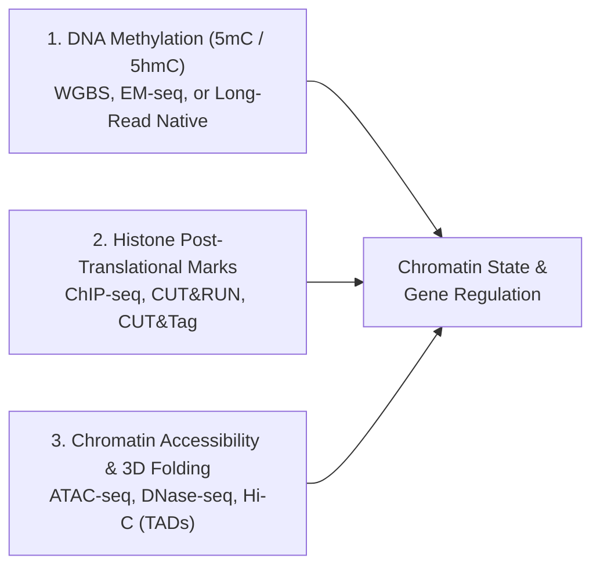

# Week 14: Epigenomics — WGBS, ChIP-seq, ATAC-seq & Peak Calling (`MACS2`)

**Course:** Applied Bioinformatics for Genomics (BFX Workshop 2025–2026)  
**Instructor:** John Garza (with Chris Miller, Ph.D.)  
**Transcription Model:** Whisper `large-v3-turbo` (`week_14_lecture.txt` / `week_14_lecture.srt`)

---

## 1. Overview of Epigenomics: Same Genome, Diverse Cell States

Every nucleated somatic cell in an organism shares the same underlying DNA sequence, yet neurons, hepatocytes, and T cells execute vastly different transcriptional programs. **Epigenomics** studies heritable and dynamic chemical modifications to DNA and chromatin structure that regulate gene expression without altering the nucleotide sequence itself:



---

## 2. DNA Methylation & Whole-Genome Bisulfite Sequencing (WGBS)

### A. CpG Dinucleotides, Islands, Shores, and Shelves
- In mammals, DNA methylation occurs predominantly at **5-methylcytosine (`5mC`)** within symmetrical **`5'-CpG-3'` dinucleotides** (~25 million CpGs in the human genome; `5hmC` is enriched in brain tissue).
- **CpG Islands:** Unmethylated, GC-rich regions ($\ge 200\text{ bp}$, $\text{GC}\% > 50\%$, observed/expected CpG ratio $> 0.60$) overlapping ~70% of human gene promoters, flanked by **shores** ($0\text{--}2\text{ kb}$), **shelves** ($2\text{--}4\text{ kb}$), and **open sea**.
- **Clinical Biomarker (*MGMT* in Glioblastoma):** The alkylating chemotherapy **temozolomide (TMZ)** kills tumor cells by damaging DNA, while the DNA repair enzyme **MGMT** reverses that damage. **Hypermethylation of the *MGMT* promoter** silences *MGMT* expression, rendering the tumor sensitive to TMZ and predicting significantly better patient survival!

### B. Bisulfite Conversion Chemistry & 3-Letter Alignment (`Bismark`, `BSMAP`, `biscuit`)
Sodium bisulfite deaminates **unmethylated Cytosine (`C`) $\rightarrow$ Uracil (`U`) $\rightarrow$ read as Thymine (`T`) after PCR**, while **methylated `5mC` is protected** and remains **`C`**:

```
Original Genomic DNA:   5' ── A   C   G   [5mC]  G   T   C   A ── 3'
                              │   │   │     │    │   │   │   │  (Sodium Bisulfite + PCR)
Bisulfite-Converted:    5' ── A   T   G     C    G   T   T   A ── 3'
                                  ▲         ▲            ▲
                         Unmethylated C->T  5mC stays C  Unmethylated C->T
```
- **Bisulfite aligners (`Bismark`, `BSMAP`, `BWA-meth`, `biscuit`)** perform 3-letter (`C`$\rightarrow$`T` / `G`$\rightarrow$`A`) alignment and compute the **methylation fraction ($\beta = C / (C + T)$)** at each CpG across the sequenced cell population ($0\%$ to $100\%$).

---

## 3. Histone Modifications & Chromatin Accessibility (`ChIP-seq`, `CUT&RUN`, `ATAC-seq`)

| Assay / Histone Mark | Biological Target / Meaning | Peak Shape |
| :--- | :--- | :--- |
| **`ChIP-seq` / `CUT&RUN` / `CUT&Tag`** | Antibody enriches DNA bound by a Transcription Factor (TF) or modified histone | Narrow (TF, `H3K4me3`) or Broad (`H3K27me3`, `H3K36me3`) |
| **`H3K4me3` / `H3K27ac`** | Active promoters (`H3K4me3`) and active enhancers/promoters (`H3K27ac`) | Sharp, narrow bimodal peaks |
| **`H3K36me3` vs. `H3K27me3`** | Actively transcribed gene bodies (`H3K36me3`) vs. Polycomb-repressed chromatin (`H3K27me3`) | Broad domains |
| **`ATAC-seq` (Tn5 Transposase)** | Hyperactive Tn5 cuts and ligates adapters directly into **open, nucleosome-free chromatin** | Sharp open-chromatin peaks + nucleosomal ladder |

---

## 4. ChIP-seq Peak Calling (`MACS2`), Overdispersion & `BigWig` Visualization

### A. Bimodal Read Shift ($d$) & Negative Binomial Modeling in `MACS2`
Sequencing the $5'$ ends of ~200 bp ChIP fragments around a binding site produces a **bimodal distribution** of forward (`+`) and reverse (`-`) reads separated by $d$. `MACS2` models $d$, shifts reads by $d/2$ toward the center, and compares ChIP signal against **Input Control DNA** using a local Poisson / **Negative Binomial** model (accounting for coverage **overdispersion**, $\text{Var} > \text{Mean}$):

```
Forward (+) Reads:       ───►  ───►  ───►
                       ╭───────╮         ╭───────╮
                      ╱         ╲       ╱         ╲    <-- Shift each strand by d/2
────────────────────[═════Protein Binding Site═════]────────────────────
                                         ◄───  ◄───  ◄─── :Reverse (-) Reads
                              ╭───────────╮
Merged Shifted Peak:         ╱   Summit    ╲           --> Output: .narrowPeak (BED6+4)
```

### B. Reproducibility (`IDR`), Chromatin States (`ChromHMM`), and Hands-On Workflow
- **IDR (Irreproducible Discovery Rate):** Ranks peaks across biological replicates to identify a reproducible peak set.
- **ChromHMM:** Uses a multivariate **Hidden Markov Model** across histone tracks to segment the genome into functional states.

```bash
# 1. Index ChIP-seq and Input Control BAMs and check PCR duplicate flag (1024)
ls -1 *.bam | xargs -n 1 samtools index
samtools view -f 1024 alz_H3K4me3_rep1.bam | wc -l

# 2. Call H3K4me3 narrow peaks against Input DNA control with MACS2 and plot shift model
macs2 callpeak -t alz_H3K4me3_rep1.bam -c alz_input_rep1.bam -f BAM -g hs -n macs_callpeak -B -q 0.01
Rscript macs_callpeak_model.r

# 3. Convert BAMs to normalized BigWig coverage tracks for scalable IGV Group Autoscale review
for i in *.bam; do bam2bw -a -r GRCh38.fasta.gz -i $i -o $(basename $i .bam).bw; done

# 4. Filter narrowPeak calls for high-confidence peaks (-log10(p-value) in column 8 > 10)
awk '$8 > 10 {print $0}' macs_callpeak_peaks.narrowPeak > macs_filtered.narrowPeak
```
