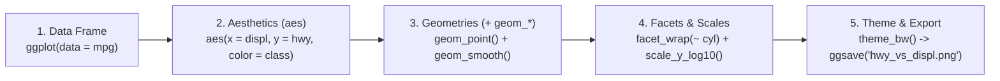

# Week 15: Data Visualization with R & `ggplot2` (Part 1: Principles & Grammar of Graphics)

**Course:** Applied Bioinformatics for Genomics (BFX Workshop 2025–2026)  
**Instructor:** Chris Miller, Ph.D.  
**Transcription Model:** Whisper `large-v3-turbo` (`week_15_lecture.txt` / `week_15_lecture.srt`)

---

## 1. Principles of Effective Scientific Visualization (Claus Wilke's *Fundamentals of Data Visualization*)

> *"A picture is worth a thousand p-values."* — Chris Miller

Effective figures must be both **truthful and immediately interpretable**, avoiding "chartjunk" (such as gratuitous 3D perspective bars or missing gridlines that obscure where values cross thresholds).

### A. Aspect Ratio, Axis Scaling & Visual Perception
- **Aspect Ratio ("Banking to 45°"):** Making a time-series plot extremely tall and narrow exaggerates slopes to look like dramatic spikes, whereas stretching it wide flattens real trends.
- **Linear vs. Logarithmic Scales (`scale_x_log10()`, `scale_y_log10()`):**
  - Biological measurements (gene expression, sequencing cost per genome, fold changes, population sizes) frequently follow **log-normal / exponential distributions**.
  - On a linear axis, 95% of data points compress into a single corner near zero while 1–2 extreme outliers dominate the plot. Log-scaling spaces multiplicative changes ($1\times, 10\times, 100\times$) evenly.

```
LINEAR SCALE (Compressed near 0):                 LOG10 SCALE (Multiplicative symmetry):
|● ● ● ●                                 ●        |  ●     ●      ●       ●        ●
+─────────────────────────────────────────►       +────────┼──────┼───────┼────────┼──►
0                                      10,000     1       10     100    1,000   10,000
```

### B. Three Distinct Functions of Color Scales
| Color Scale Type | Purpose | Recommended Palette Examples |
| :--- | :--- | :--- |
| **1. Qualitative (Categorical)** | **Distinguish** discrete, unordered groups (e.g., cell types, chromosomes, genotypes) | `Okabe-Ito` (colorblind-safe), `Set1`, `Dark2` |
| **2. Sequential / Diverging** | **Represent continuous data values** (e.g., expression `TPM` from low to high, or $\log_2\text{FC}$ centered at `0`) | Sequential: `viridis`, `magma`; Diverging: `Blue-White-Red` (`scale_fill_gradient2`) |
| **3. Highlight / Accent** | **Draw attention** to specific features (e.g., 1 target gene or cluster in vivid color against muted gray background) | Muted gray (`#CCCCCC`) + saturated accent color |

### C. Showing the Underlying Data Distribution (Granularity)
- **Bar plots with error bars ("dynamite plots")** hide sample size, bimodality, and outliers, and **must always start at `0`** because the human eye judges bar magnitude by total bar area/length.
- **Superior Alternatives:** Combine **`geom_boxplot(outlier.shape = NA)`** or **`geom_violin()`** with **`geom_jitter(width = 0.2)`** (or beeswarm/sinaplots) so the reader sees both summary quantiles and every individual biological replicate!

```
BAR + ERROR BAR (Hides bimodality):     BOXPLOT + JITTERED POINTS (Reveals true distribution):
        ┬                                        ┌───┬───┐
      ┌─┴─┐                                  •   │ • │ • │  •
      │   │                                  •   └───┴───┘  •     (Shows every sample!)
──────┴───┴──────                       ─────────────────────────
```

---

## 2. The Layered Grammar of Graphics in `ggplot2`

Unlike base R plotting (where functions draw static ink onto a canvas), `ggplot2` constructs plots modularly by combining a **Data Frame**, **Aesthetic Mappings (`aes`)**, **Geometric Layers (`geom_*`)**, **Scales**, **Facets**, and **Themes** using the `+` operator:



### Key `ggplot2` Concepts & Pitfalls Practiced in Lecture
1. **Mapping (`aes(color = class)`) vs. Setting (`geom_point(color = "blue")`):**
   - Put variables **inside `aes()`** when color/size/shape depends on a data column.
   - Put constants **outside `aes()`** when setting a fixed visual style (writing `aes(color = "blue")` creates a fake 1-level categorical legend labeled `"blue"` coloured salmon-pink!).
2. **Global vs. Layer-Specific Aesthetics:** Aesthetics placed in `ggplot(mpg, aes(...))` are inherited by all subsequent layers (`geom_point()`, `geom_smooth()`), whereas aesthetics placed inside `geom_point(aes(color = class))` apply only to that layer (allowing a single global `geom_smooth()` trend line across all classes).
3. **Continuous vs. Categorical (`factor`) & `Date` Variables:** Convert integer categories (like cylinder count `cyl`) with `factor(cyl)` for discrete colors, and strings with `as.Date("1990-01-01")` before setting date axis limits.

```r
library(ggplot2)

# Build multi-layer plot with class colors, single loess trend line, facets, and export to PNG
p <- ggplot(data = mpg, mapping = aes(x = displ, y = hwy)) +
  geom_point(mapping = aes(color = class), size = 2, alpha = 0.8) +
  geom_smooth(method = "loess", se = TRUE, color = "black") +
  facet_wrap(~ cyl, nrow = 2) +
  theme_bw() +
  labs(title = "Highway MPG vs Engine Displacement", x = "Displacement (L)", y = "Highway MPG")

ggsave(filename = "hwy_vs_displ.png", plot = p, width = 8, height = 5, dpi = 300)
```
