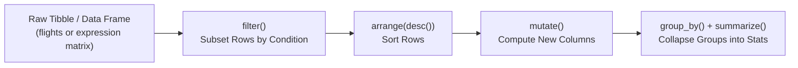

# Week 16: Data Visualization with R & `ggplot2` (Part 2: Data Wrangling & Tidy Genomics Plots)

**Course:** Applied Bioinformatics for Genomics (BFX Workshop 2025–2026)  
**Instructor:** Chris Miller, Ph.D.  
**Transcription Model:** Whisper `large-v3-turbo` (`week_16_lecture.txt` / `week_16_lecture.srt`)

---

## 1. Why Data Wrangling Is 80% of Scientific Plotting

Generating complex figures in `ggplot2` is straightforward once data is properly structured, but real-world experimental matrices (e.g., proteomics LFQ spreadsheets or gene expression matrices with 50 sample columns) are stored in **human-readable wide format**, whereas `ggplot2` requires **tidy (long) format** where every column is a single variable and every row is a single observation.

```
WIDE MATRIX (Human-Readable Spreadsheet):            TIDY / LONG TABLE (ggplot2-Ready via pivot_longer):
┌─────────┬──────────┬──────────┬───────────┐        ┌─────────┬───────────┬────────────┬─────────┐
│ Protein │ HD_01    │ AML_01   │ AML_02    │        │ Protein │ Sample    │ Expression │ Group   │
├─────────┼──────────┼──────────┼───────────┤  ───►  ├─────────┼───────────┼────────────┼─────────┤
│ NPM1    │ 24.1     │ 28.5     │ 29.0      │        │ NPM1    │ HD_01     │ 24.1       │ Control │
│ GOT2    │ 19.8     │ 22.4     │ 23.1      │        │ NPM1    │ AML_01    │ 28.5       │ Case    │
└─────────┴──────────┴──────────┴───────────┘        │ NPM1    │ AML_02    │ 29.0       │ Case    │
                                                     └─────────┴───────────┴────────────┴─────────┘
```

---

## 2. Core `dplyr` Data Transformation Verbs (`R for Data Science` / `nycflights13`)

The `tidyverse` chains single-purpose data-frame verbs together using the pipe operator (`%>%` or `|>`), where the data frame on the left is passed implicitly as the first argument to the function on the right:



| `dplyr` / `tidyr` Verb | Operates On | Purpose | Example |
| :--- | :--- | :--- | :--- |
| **`filter()`** | Rows | Keep rows matching boolean conditions (`==`, `!=`, `%in%`, `&`, `\|`) | `flights \|> filter(month == 1, dest %in% c("IAH", "HOU"))` |
| **`arrange()`** | Rows | Reorder rows ascending or descending (`desc()`) | `flights \|> arrange(desc(dep_delay))` |
| **`distinct()`** | Rows | Deduplicate unique rows or unique column combinations | `flights \|> distinct(origin, dest, .keep_all = TRUE)` |
| **`mutate()`** | Columns | Create new columns derived from existing columns | `flights \|> mutate(speed = distance / air_time * 60)` |
| **`select()` / `rename()`** | Columns | Keep, drop (`-col`), reorder, or rename columns | `flights \|> select(year, month, day, dep_delay)` |
| **`group_by()` + `summarize()`** | Groups | Stratify by category and compute summary metrics (`mean`, `n()`) | `flights \|> group_by(month) \|> summarize(avg = mean(dep_delay, na.rm=TRUE))` |
| **`pivot_longer()`** | Shape | Convert wide sample columns into tidy key-value rows | `lfq %>% pivot_longer(cols = -Protein, names_to = "Sample", values_to = "Expression")` |

---

## 3. Automated Multi-Gene Boxplots (`geneplots.md` AML Proteomics Workflow)

When inspecting top candidate genes/proteins (`NPM1`, `A1BG`, `ABCA1`, `GOT2`, `MPO`) across Healthy Donors (`HD` Control) vs. AML Cases, we pivot the matrix once, annotate groups with `grepl()`, loop through candidate genes to store `ggplot` objects in a list, and tile them into a multi-page PDF with `gridExtra::marrangeGrob()`:

```r
library(tidyr); library(ggplot2); library(dplyr); library(gridExtra)

# 1. Read wide proteomics table without prepending 'X' to numeric sample names
lfq <- read.csv("/tmp/protein_lfq.csv", check.names = FALSE)[, 1:51]

# 2. Pivot from wide to tidy long format & annotate Healthy Donor (HD) controls vs AML cases
prot.long <- lfq %>%
  pivot_longer(cols = -Protein, names_to = "Sample", values_to = "Expression")
prot.long$Group <- "Case"
prot.long[grepl("HD", prot.long$Sample), "Group"] <- "Control"

# 3. Loop over candidate genes and build boxplot + jittered points (suppress duplicate outliers!)
p <- list()
for (gene in c("NPM1", "A1BG", "ABCA1", "GOT2", "MPO")) {
  df <- prot.long[prot.long$Protein == gene, ]
  p[[gene]] <- ggplot(df, aes(x = Group, y = Expression, fill = Group)) +
    geom_boxplot(outlier.shape = NA) +
    geom_jitter(width = 0.2) +
    ggtitle(gene)
}

# 4. Tile plots 1x2 per page into a single multi-page PDF
ggsave(filename = "boxplots.pdf", plot = marrangeGrob(p, nrow = 1, ncol = 2, top = NULL), width = 8, height = 4)
```

---

## 4. Constructing Publication Volcano Plots in `ggplot2` (`ggrepel`)

```r
# Categorize differentially expressed genes and label top hits without overlapping text
de$diffexpressed <- "NO"
de$diffexpressed[de$log2FoldChange >  0.6 & de$pvalue < 0.05] <- "UP"
de$diffexpressed[de$log2FoldChange < -0.6 & de$pvalue < 0.05] <- "DOWN"
de$delabel <- ifelse(de$diffexpressed != "NO", de$gene_symbol, NA)

ggplot(data = de, aes(x = log2FoldChange, y = -log10(pvalue), col = diffexpressed, label = delabel)) +
  geom_point() +
  theme_minimal() +
  ggrepel::geom_text_repel() +
  scale_color_manual(values = c("blue", "black", "red")) +
  geom_vline(xintercept = c(-0.6, 0.6), col = "red") +
  geom_hline(yintercept = -log10(0.05), col = "red")
```
