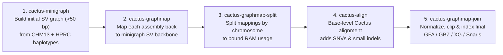

# Week 17: Linear Genome & Pangenome Assembly — Core Concepts & Visualizations

**Course:** Applied Bioinformatics for Genomics (BFX Workshop 2025–2026)  
**Instructor:** Juan F. Macias-Velasco, Ph.D. (with John Garza)  
**Transcription Model:** Whisper `large-v3-turbo` (`week_17_lecture.txt` / `week_17_lecture.srt`)

---

## 1. De Novo Linear Genome Assembly: Contigs, Scaffolds & Phasing

Every reference-based omics assay (WGS, RNA-seq, ChIP-seq) depends on a high-quality reference assembly. **De novo genome assembly** reconstructs a genome directly from sequencing reads without a prior reference:

```
1. Raw Long Reads (PacBio HiFi / ONT)   ──►  ───   ───   ───     ───   ───
2. Overlapping Consensus -> CONTIGS     ──► [════Contig 1════]  [═══Contig 2═══]   (Gapless sequences)
3. Hi-C / BioNano Optical -> SCAFFOLDS  ──► [════Contig 1════]NNN[═══Contig 2═══]  (Ordered & oriented with N gaps)
4. Telomere-to-Telomere (T2T) Phased    ──► Maternal & Paternal Chromosome-Scale Haplotypes (e.g. T2T-CHM13 / HPRC)
```

### Two Core Algorithmic Paradigms for Genome Assembly
| Paradigm | Graph Structure | Primary Read Type & Assemblers |
| :--- | :--- | :--- |
| **De Bruijn Graph (DBG)** | Breaks reads into short **$k$-mers** (nodes = $k$-mers, edges = $k-1$ overlaps) and traverses an Eulerian path | **Short reads** (`MEGAHIT`, `ABySS`, `SPAdes`); fast, but collapses repeats longer than $k$ |
| **Overlap-Layout-Consensus (OLC) / String Graph** | Performs all-vs-all read alignment (nodes = full reads, edges = suffix-prefix overlaps) | **Long reads** (`FALCON-Unzip`, `Canu`, **`hifiasm`**); spans kilobase repeats and phases diploid haplotypes |

### Evaluating Assembly Quality: Contiguity (`N50`), Completeness (`BUSCO`), and Phasing
- **Contig / Scaffold `N50`:** Sort all contigs from longest to shortest and sum their lengths until reaching **50% of the total assembly length**; the length of the contig at that 50% mark is the **`N50`** (higher `N50` = more contiguous).
- **Completeness (`BUSCO`):** Measures the fraction of evolutionarily conserved single-copy orthologous genes recovered intact.
- **Diploid Haplotype Phasing (`FALCON-Unzip` / Trio `hifiasm`):** Unzips heterozygous "bubbles" in the assembly string graph using linked SNVs and parental $k$-mers to produce separate **maternal and paternal haplotigs**.

---

## 2. Why Move from a Single Linear Reference to a Pangenome Graph?

A single linear reference genome (`GRCh38` or `T2T-CHM13`) represents only **one mosaic haplotype**, creating **reference bias**: reads from individuals carrying non-reference insertions, deletions, or divergent alleles fail to map or map with low quality (`MAPQ`). The **Human Pangenome Reference Consortium (HPRC)** combines hundreds of phased diploid assemblies into a **pangenome sequence graph** where:
- **Nodes (Segments `S`):** DNA sequence strings shared by one or more haplotypes.
- **Edges (Links `L`):** Directed connections between consecutive nodes.
- **Paths / Walks (`P` / `W`):** Individual chromosome haplotypes threading through the graph.

```
LINEAR REFERENCE (Only Reference Allele "G" or 1 Structural Path Exists):
──[ A T G C ]──[   G   ]──[ T T A G ]──   (Reads with "A" or 500 bp Insertion suffer Reference Bias!)

PANGENOME VARIATION GRAPH (Both Alleles & Structural Variants Represented Equally as Bubbles):
               ╭──[   G (Ref)   ]──╮
──[ A T G C ]──┤                   ├──[ T T A G ]──
               ╰──[ A / 500bpSV ]──╯
```

---

## 3. Constructing & Visualizing Pangenome Graphs (`Minigraph-Cactus` & `Bandage`)

### A. The 5-Step `Minigraph-Cactus` Pipeline (`mcgb.sh`)


### B. Pangenome Graph File Formats & Indices (`out/` Directory)
| Extension | File Type | Purpose in Graph Genomics (`vg` / `Giraffe`) |
| :--- | :--- | :--- |
| **`.gfa` / `.gbz`** | **Graph File** | **Graphical Fragment Assembly** (`.gfa` text; `.gbz` compressed graph + GBWT haplotype paths) |
| **`.xg`** | **Graph Index** | Succinct static graph index for rapid coordinate/context queries |
| **`.dist` & `.min`** | **Aligner Indices** | Distance index (`.dist`) + minimizer seed index (`.min`) used by **`vg giraffe`** for fast short/long-read graph mapping |
| **`.snarls`** | **Bubble Index** | Catalog of nested variant "bubbles" (snarls) used for graph variant calling |
| **`.hal` & `.vcf.gz`** | **Alignment / Variants** | Hierarchical Alignment format (`.hal`) and projected linear `.vcf.gz` |

### C. Visualizing Node `8737` in `Bandage`
Loading `bschr8.gfa` into **Bandage** and jumping to node **`8737`** reveals a **structural variant bubble / copy-number loop** where the maternal and paternal haplotypes of `HG00621` take divergent node paths relative to `T2T-CHM13`. In a linear reference, this region collapses or appears as unmappable gaps/soft-clips, whereas the graph represents both structural haplotypes losslessy.
