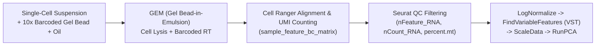

# Week 18: Single-Cell RNA-seq (Day 1: Droplet Chemistry, QC, Normalization & PCA in `Seurat`)

**Course:** Applied Bioinformatics for Genomics (BFX Workshop 2025–2026)  
**Instructor:** Jennifer A. Foltz, Ph.D.  
**Transcription Model:** Whisper `large-v3-turbo` (`week_18_lecture.txt` / `week_18_lecture.srt`)

---

## 1. Bulk RNA-seq ("Smoothie") vs. Single-Cell RNA-seq ("Fruit Salad")

- **Bulk RNA-seq ("Smoothie"):** Averages transcript expression across hundreds of thousands of cells, masking rare cell populations, immune infiltrates, and cell-state transitions, though providing deeper coverage of lowly expressed transcripts.
- **Single-Cell RNA-seq ("Fruit Salad"):** Profiles gene expression per individual cell, enabling *in silico* sorting and cellular heterogeneity discovery, at the cost of higher sparsity ("dropouts").



---

## 2. 10x Genomics Chromium Droplet Architecture & Assay Chemistries

Inside each microfluidic **GEM (Gel Bead-in-Emulsion)**, a single cell is co-encapsulated with a dissolvable gel bead coated with millions of oligonucleotide primers containing:

```
5' ──[Illumina Read 1 Primer (22 nt)]──[10x Cell Barcode (16 nt)]──[UMI (10-12 nt)]──[Poly(dT) or TSO]── 3'
                                        └───────────┬───────────┘   └──────┬──────┘
                                      Shared by all mRNAs in 1 GEM   Unique to 1 mRNA molecule (removes PCR bias)
```

| 10x Chemistry | Capture Mechanism | Key Strengths & Limitations |
| :--- | :--- | :--- |
| **3' Gene Expression** | Oligo(dT) captures $3'$ poly(A) tail | Standard whole-transcriptome profiling; supports spliced/unspliced **RNA velocity** |
| **5' Gene Expression** | Template Switching Oligo (TSO) at $5'$ end | Enables paired **TCR / BCR V(D)J immune repertoire clonotyping** from the same cells |
| **Flex (Fixed RNA)** | Hybridization probe pairs on PFA-fixed cells | Works on fixed/FFPE tissues; higher sensitivity, but cannot sequence outside probe set |

---

## 3. Primary Processing (`Cell Ranger`) & `Seurat` Quality Control (`VlnPlot`)

### A. Barcode Rank Plot ("Knee Plot") in `Cell Ranger`
Plots UMI counts per barcode (log-log): true cell-containing droplets form a high-UMI plateau ($10^3\text{--}10^4$ UMIs) before a sharp **"cliff/knee"** dropping into empty droplets containing only ambient background RNA.

### B. Three Core Cell-Level QC Metrics in `Seurat`
When cells lyse or undergo apoptosis, cytoplasmic mRNAs leak out through compromised cell membranes while larger **mitochondrial transcripts (`^MT-`)** remain trapped inside mitochondria, causing dying cells to exhibit **low `nFeature_RNA` and high `percent.mt`**:

| Seurat Metadata Metric | What It Measures | Artifact Filtered Out |
| :--- | :--- | :--- |
| **`nFeature_RNA`** | Number of unique genes detected in the cell | **Too low (`<200`):** Empty droplet / cell debris; **Too high (`>5,000–10,000`):** Multiplet / doublet |
| **`nCount_RNA`** | Total UMI molecules sequenced in the cell | **Too high (`>20,000`):** Doublet (2+ cells encapsulated in one GEM) |
| **`percent.mt`** (`^MT-` or `^mt-`) | Percentage of reads mapping to mitochondrial genes | **Too high (`>10%–15%`):** Dying, stressed, or lysed cells |

---

## 4. Normalization, Feature Selection (`VST`), Scaling & PCA

1. **Depth Normalization (`NormalizeData`):** Divides each gene's UMI count by the cell's total UMI count, multiplies by `scale.factor = 10000`, adds a pseudocount of `1`, and takes the natural logarithm: $\ln\left(\frac{\text{UMI}_i}{\sum \text{UMI}} \times 10^4 + 1\right)$.
2. **Highly Variable Genes (`FindVariableFeatures(selection.method = "vst", nfeatures = 2000)`):** Fits a loess curve of $\log(\text{variance})$ vs. $\log(\text{mean})$ across all genes and selects the **2,000–3,000 genes** with the highest standardized biological variance across cells.
3. **Z-Score Scaling (`ScaleData`):** Centers each gene to mean $0$ and standard deviation $1$ across cells so highly expressed housekeeping genes do not dominate PCA.
4. **Principal Component Analysis (`RunPCA`) & Choosing PCs:** Compresses the 2,000 variable genes into orthogonal axes of maximal variation. Select the number of PCs (e.g., `PC = 10` to `30`) using **`ElbowPlot`**, **`DimHeatmap`**, and biological marker inspection (too few PCs merges distinct lineages like NK and T cells; too many PCs introduces technical noise).

```r
library(Seurat); library(ggplot2); library(dplyr)

object.data <- Read10X("sample_feature_bc_matrix")
object <- CreateSeuratObject(object.data$`Gene Expression`, project = "PBMC_10k")
object[["percent.mt"]] <- PercentageFeatureSet(object, pattern = "^MT-", assay = "RNA")

# Filter low-quality / dying cells and doublets, then normalize, find HVGs, scale, and run PCA
object <- subset(object, nFeature_RNA > 200 & nFeature_RNA < 10000 & percent.mt < 15 & nCount_RNA < 20000)
object <- NormalizeData(object, normalization.method = "LogNormalize", scale.factor = 10000)
object <- FindVariableFeatures(object, selection.method = "vst", nfeatures = 2000)
object <- ScaleData(object, features = rownames(object))
object <- RunPCA(object, features = VariableFeatures(object))
saveRDS(object, file = "bfxworkshop.rds")
```
