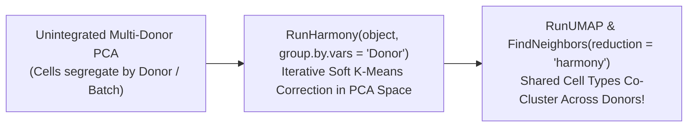

# Week 19: Single-Cell RNA-seq (Day 2: UMAP, Clustering, Batch Correction & CITE-seq)

**Course:** Applied Bioinformatics for Genomics (BFX Workshop 2025–2026)  
**Instructor:** Jennifer A. Foltz, Ph.D.  
**Transcription Model:** Whisper `large-v3-turbo` (`week_19_lecture.txt` / `week_19_lecture.srt`)

---

## 1. Non-Linear Dimensionality Reduction (`t-SNE` vs. `UMAP`)

After selecting the top Principal Components (e.g., `PC 1:14`), `Seurat` projects high-dimensional PCA space into a 2D embedding for visualization using **t-SNE** or **UMAP (Uniform Manifold Approximation and Projection)**:

```
High-Dimensional Gene Space (~2,000 Variable Genes)
        │
        ▼  Linear Orthogonal Projection (RunPCA)
Top N Principal Components (e.g. PC 1..14)
        ├──► 1. Non-Linear 2D Embedding (RunUMAP / RunTSNE)  --> Visualization ONLY!
        └──► 2. Shared Nearest Neighbor Graph (FindNeighbors) + Louvain/Leiden (FindClusters)
```

| Property | `t-SNE` | `UMAP` |
| :--- | :--- | :--- |
| **Structure Preserved** | Preserves **local** neighborhood structure only | Preserves **both local and global** manifold structure |
| **Computational Speed** | Slower on large cell counts | Significantly faster and more scalable |
| **Critical Caveat** | **Never over-interpret 2D visual distances as quantitative proof!** Always validate relationships in PCA/graph space (`FindClusters`) and with differential expression (`FindMarkers`). |

### Diagnosing Technical Confounders Driving UMAP Layout
Before biological interpretation, inspect `FeaturePlot` for `nCount_RNA`, `nFeature_RNA`, `percent.mt`, cell-cycle genes (`MKI67`, `TOP2A`), and top PC loadings (`PC_1`, `PC_2`) to ensure islands are not driven by dying cells or sequencing depth.

---

## 2. Graph-Based Clustering (`FindNeighbors` & `FindClusters`) & Marker Discovery

1. **KNN / SNN Graph (`FindNeighbors`):** Connects each cell to its $k$ nearest neighbors in **PCA space** and weights edges by shared neighborhood overlap (Jaccard index).
2. **Modularity Optimization (`FindClusters(resolution = ...)`):** Partitions the SNN graph into communities.
   - **Lower resolution (`0.2`–`0.4`):** Fewer, broader cell-type clusters (e.g., all T cells together).
   - **Higher resolution (`0.8`–`1.5+`):** Splits into finer subpopulations (e.g., naive CD4+, effector CD8+, regulatory T cells).Tools like `clustree` visualize how clusters split across resolutions.
3. **Differential Expression & Marker Annotation (`FindAllMarkers` vs. `FindMarkers`):**
   - `FindAllMarkers(only.pos = TRUE, min.pct = 0.25, logfc.threshold = 0.25)`: Compares each cluster against **all other cells combined**; always filter downstream on **`p_val_adj < 0.05`** (not unadjusted `return.thresh`)!
   - **Canonical PBMC Immune Markers:**
     - **T cells:** `CD3D`, `CD3E`, `CD4` (Helper), `CD8A` (Cytotoxic)
     - **NK cells:** `NCAM1` (CD56), `GNLY`, `NKG7`, `GZMK`
     - **B cells:** `CD79A`, `MS4A1` (CD20), `CD19`
     - **Monocytes / Myeloid:** `LYZ`, `CD14`, `FCGR3A` (CD16)
     - **HSPCs / Progenitors:** `CD34`

---

## 3. Multi-Sample Integration & Batch Correction (`Harmony`)

When combining multiple donors, timepoints, or 10x runs, technical **batch effects** cause cells to separate by sample rather than cell type.



### Golden Rules of scRNA-seq Experimental Design & Batch Correction
- **DO:** Process control and experimental groups together on the same day/chip whenever possible, and include shared control cell spikes.
- **DON'T:** **Never batch-correct on your biological variable of interest** (e.g., if Donor 1 = Untreated and Donor 2 = Drug-Treated on separate days, batch-correcting by sample regresses out the drug treatment effect!).
- **Sub-clustering (`subset`):** When isolating a single lineage (e.g., T/NK cells) to re-cluster at higher resolution, you **must re-run `FindVariableFeatures()` $\rightarrow$ `ScaleData()` $\rightarrow$ `RunPCA()` $\rightarrow$ `RunHarmony()`** on the subset.

---

## 4. CITE-seq (Surface Protein ADT) Normalization (`CLR` vs. `dsb`) & `scCustomize`

**CITE-seq** measures surface proteins alongside mRNA using **oligo-conjugated antibodies (ADTs)**. Unlike sparse mRNA counts, ADT protein data exhibits background noise from **ambient unbound antibodies in empty droplets** and non-specific **isotype control** binding:

| Normalization Method | Mechanism | Best Use Case |
| :--- | :--- | :--- |
| **`CLR` (`margin = 1`)** | Centered Log-Ratio normalized across cells per protein feature | Visualizing relative low-to-high expression of individual markers |
| **`CLR` (`margin = 2`)** | Centered Log-Ratio normalized across proteins per cell | Assumes total antibody staining per cell is constant (risky if antibody panel is small/biased) |
| **`dsb` (Denoised & Scaled by Background)** | Subtracts ambient protein background estimated from **10x empty droplets** + denoises technical cell-to-cell variation using **isotype controls** | **Gold standard** for quantitative multi-protein CITE-seq analysis |

```r
library(Seurat); library(harmony); library(scCustomize)

object <- readRDS("bfxworkshop.rds")
DimPlot_scCustom(object, label = TRUE, figure_plot = TRUE)
Cluster_Highlight_Plot(object, cluster_name = "1", highlight_color = "purple2", background_color = "black")

# Identify top cluster markers with percent expression difference (pct.1 - pct.2)
markers <- FindAllMarkers(object, min.pct = 0.25, logfc.threshold = 0.25, only.pos = TRUE) %>% Add_Pct_Diff()
markers <- markers[markers$p_val_adj < 0.05, ]
FeaturePlot_scCustom(object, features = c("CD3D", "CD79A", "NCAM1", "CD4", "CD8A", "LYZ", "CD34", "FCGR3A"), num_columns = 4)
```
