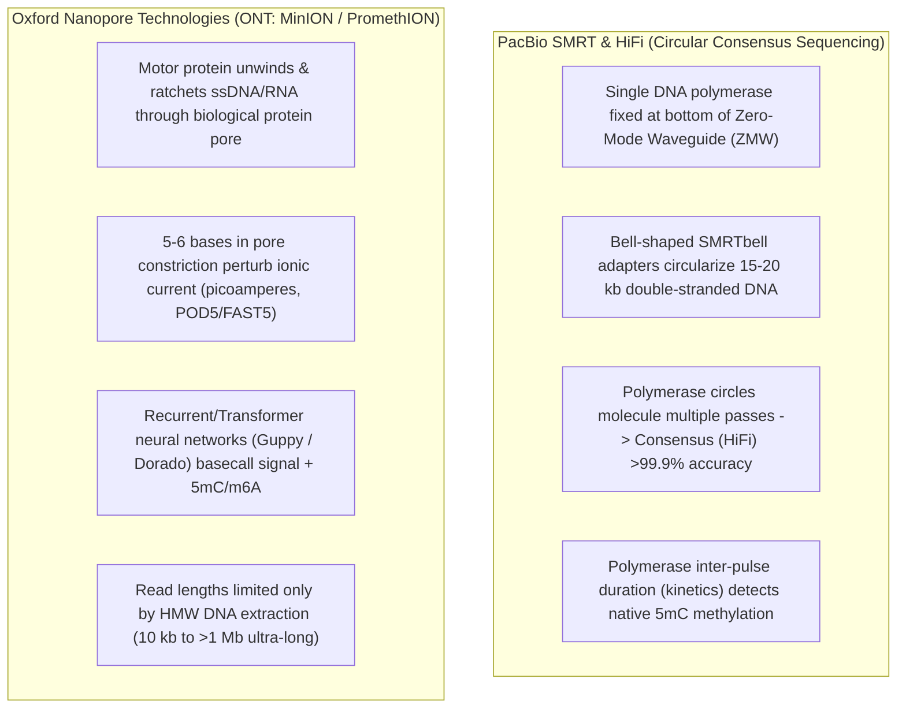
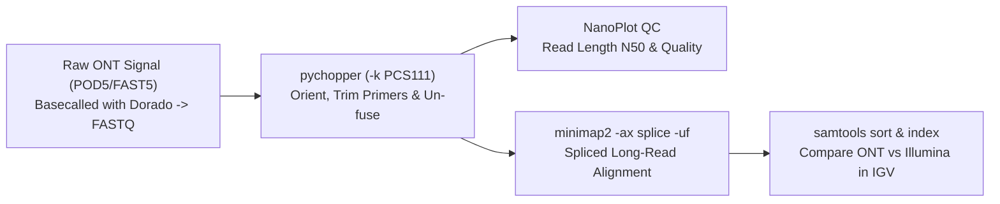

# Week 20: Long-Read Sequencing & Alignment — Core Concepts & Visualizations

**Course:** Applied Bioinformatics for Genomics (BFX Workshop 2025–2026)  
**Instructor:** Chris Miller, Ph.D.  
**Transcription Model:** Whisper `large-v3-turbo` (`week_20_lecture.txt` / `week_20_lecture.srt`)

---

## 1. Short-Read vs. Long-Read Sequencing Technologies

While Illumina short-read sequencing ($2 \times 150\text{ bp}$, ~0.1–0.3% substitution error rate, ~$100–$500/genome) excels at SNV detection in unique regions, its short read length cannot span long repeats (*Alu*, LINEs, centromeres), phase distant heterozygous variants, or capture full-length mRNA splice isoforms in a single read.



| Feature | Illumina Short-Read | PacBio HiFi (Revio) | Oxford Nanopore (ONT PromethION) |
| :--- | :--- | :--- | :--- |
| **Typical Read Length** | $2 \times 150\text{ bp}$ | $15\text{--}25\text{ kb}$ | $10\text{ kb} \text{ to } >100\text{ kb}$ (RNA: full transcript length) |
| **Base Accuracy & Error Mode** | ~99.7–99.9% (substitutions) | ~99.9% (CCS multi-pass consensus) | ~95–99%+ (Duplex/Dorado; **homopolymer indels**) |
| **Native Epigenetics?** | No (requires bisulfite/EM-seq) | **Yes** (5mC via polymerase kinetics) | **Yes** (5mC, 5hmC, m6A in direct RNA) |
| **Raw Signal Retention** | Discarded after BCL->FASTQ | Summarized to HiFi BAM | **Keep `POD5`/`FAST5` (~1 TB)** for re-basecalling as neural nets improve |

---

## 2. Why Long Reads Excel: Structural Variants, Phasing & Full-Length Isoforms

### A. Resolving Large Indels, Repeat Expansions (*FLT3*-ITD), and Complex SVs
Short reads fail to map cleanly across large insertions (like **FLT3 Internal Tandem Duplications** in AML) or repetitive breakpoints (`MAPQ = 0` or unmapped soft-clips). A single $15\text{ kb}$ long read spans the entire insertion or translocation breakpoint with kilobases of unique flanking anchor sequence on both sides.

### B. Full-Length Transcript Isoform Resolution (`FLAIR`, `ESPRESSO`, `IsoQuant`)
In short-read RNA-seq (`StringTie`), assembling multi-exon isoforms requires statistical inference across fragmented $150\text{ bp}$ reads, losing phasing between distant alternative exons. Long-read cDNA/direct-RNA sequencing sequences the **entire mRNA molecule from $5'$ to $3'$ in a single read**:

```
Gene with 2 Distant Alternative Exons (Exon 2A/2B and Exon 6A/6B):
Short Reads (150 bp):   [─]   [─]       [─]   [─]       [─]    --> Cannot tell if 2A pairs with 6A or 6B!
Long Read 1 (2.5 kb):   [Ex1]─[Ex2A]────[Ex3]─[Ex4]─[Ex5]─[Ex6B] --> Directly observes full-length isoform!
Long Read 2 (2.2 kb):   [Ex1]───────────[Ex3]─[Ex4]─[Ex5]─[Ex6A] --> Exon skipping + 6A directly linked!
```

### Categories of Isoforms Discovered by Long-Read RNA-seq (`SQANTI` / `ESPRESSO`)
- **FSM (Full Splice Match):** Matches a known reference transcript (Ensembl/GENCODE) across all splice junctions.
- **ISM (Incomplete Splice Match):** Matches a subset of consecutive known junctions (often caused by **$5'$ RNA degradation / truncation** in long genes like *DNMT3A* when RIN is suboptimal!).
- **NIC (Novel In Catalog):** Novel combination of **known** splice donors/acceptors (e.g., novel exon skipping in *MX1* in *SRSF2*-mutant AML).
- **NNC (Novel Not in Catalog):** Uses at least one previously unannotated splice donor or acceptor site.

---

## 3. Hands-On ONT cDNA Pipeline (`pychopper` → `NanoPlot` → `minimap2` → `IGV`)



```bash
# 1. Identify primers, orient cDNA reads, trim adapters, and split fused chimeric reads
pychopper -t 4 -m edlib -k PCS111 -r pychopper_report.pdf -S pychopper_stats.txt \
  k562_ont_raw.fastq.gz | gzip > k562_ont_trimmed.fastq.gz

# 2. Run long-read QC (read length histograms, N50, mean Phred quality vs length)
NanoPlot --fastq k562_ont_trimmed.fastq.gz --prefix nanoplot/

# 3. Align long cDNA reads with minimap2 (no pre-indexing required; -ax splice -uf for stranded exons)
minimap2 -ax splice -uf ref_genome_sm.fa.gz k562_ont_trimmed.fastq.gz > k562_ont.sam
samtools view -Sb k562_ont.sam | samtools sort > k562_ont.bam
samtools index k562_ont.bam
```
