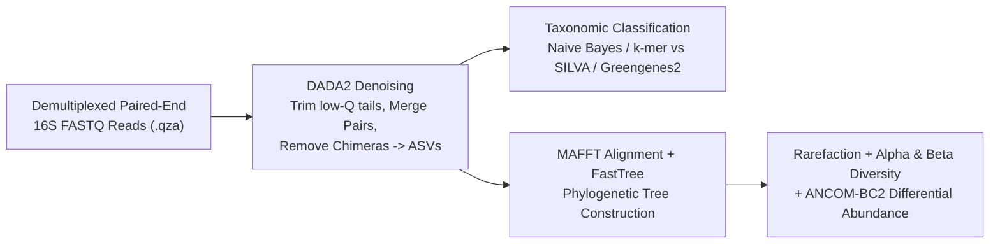

# Week 21: Microbial Genomics & 16S Metagenomics (`QIIME 2`) — Core Concepts & Visualizations

**Course:** Applied Bioinformatics for Genomics (BFX Workshop 2025–2026)  
**Instructor:** Brigida Rusconi, Ph.D.  
**Transcription Model:** Whisper `large-v3-turbo` (`week_21_lecture.txt` / `week_21_lecture.srt`)

---

## 1. Microbiome Study Design: 16S Amplicon vs. Shotgun Metagenomics

The host-associated microbiota imprints immune tolerance and metabolism (especially during early life) and influences systemic physiology across the gut-brain, gut-liver, and gut-lung axes. Two primary sequencing strategies profile microbial communities:

```
                   16S rRNA GENE (~1,500 bp: 9 Hypervariable Regions V1–V9)
5' ──[Conserved]══[V1]══[V2]══[Conserved]══[V3]══[V4]══[Conserved]══[V5]..[V9]── 3'
                                        ├───►        ◄───┤
                              PCR Primers bind conserved flanks;
                              amplified V4 variable region identifies genus/taxon!
```

| Feature | 16S rRNA Amplicon Sequencing (e.g., V4 / V3-V4) | Whole-Genome Shotgun Metagenomics |
| :--- | :--- | :--- |
| **Target Sequenced** | PCR-amplified bacterial 16S rRNA hypervariable region (or fungal `ITS`) | All extracted DNA sheared and sequenced (bacteria, viruses, fungi, host) |
| **Taxonomic Resolution** | **Phylum to Genus** (rarely species/strain unless full-length long-read 16S) | **Species and Strain level** + plasmids & mobile elements |
| **Functional Profiling** | Indirect inference only (`PICRUSt2`) | **Direct measurement** of metabolic pathways, virulence, and AMR genes |
| **Cost & Host DNA Contamination** | Cheap, scales to hundreds of samples; PCR bypasses host DNA in mucosal biopsies (unless columns saturate) | Expensive; high host DNA in biopsies requires microbial enrichment (`MEM`) or deep sequencing |
| **Absolute Quantification?** | Relative abundance only (unless **ZymoBIOMICS spike-in control** or qPCR is added) | Relative abundance (compositional data) |

### Handling Low-Biomass Samples & Extraction Controls
- Extraction kits ("kitome") and reagents contain trace bacterial DNA. Always sequence **negative extraction controls (blank swabs/water)** and use statistical decontamination (`decontam` R package) plus uniform mechanical lysis (**bead-beating** to lyse tough Gram-positive spores).

---

## 2. End-to-End `QIIME 2` 16S Bioinformatics Workflow

`QIIME 2` encapsulates data and full provenance tracking inside compressed **Artifacts (`.qza`)** and **Visualizations (`.qzv`, viewable at `view.qiime2.org`)**:



### OTUs (97% Clustering) vs. ASVs (`DADA2` / `Deblur`)
- **Legacy OTUs (Operational Taxonomic Units):** Clustered reads at an arbitrary **97% similarity threshold**, merging distinct species and failing to compare across studies.
- **Modern ASVs (Amplicon Sequence Variants via `DADA2`):** Models per-base Illumina error rates to resolve **exact single-nucleotide differences** while removing PCR **chimeras** (hybrid amplicons formed from two parent templates during PCR).

---

## 3. Alpha Diversity, Beta Diversity & Compositional Differential Abundance (`ANCOM-BC2`)

Before diversity calculation, samples are **rarefied** (subsampled to an even read depth at the plateau of the alpha rarefaction curve) so library size does not bias richness.

### A. Alpha Diversity (Within-Sample Diversity)
| Metric | What It Measures | Key Property |
| :--- | :--- | :--- |
| **Observed Richness / `Chao1` / `Faith's PD`** | Total number of taxa present (`Faith's PD` weights by phylogenetic branch length) | Qualitative (presence/absence) |
| **Shannon Index ($H'$)** | Combines **species richness and evenness** | Sensitive to both rare and abundant taxa |
| **Simpson Index / Pielou's Evenness** | Measures community **evenness** and dominance | Emphasizes dominant taxa |

### B. Beta Diversity (Between-Sample Dissimilarity & PCoA Ordination)
| Distance Metric | Quantitative (Abundance)? | Phylogenetic (Tree-Based)? | Best For Detecting |
| :--- | :---: | :---: | :--- |
| **Jaccard Distance** | No (Presence/Absence) | No | Gain/loss of rare taxa (e.g., bacterial transfer) |
| **Bray-Curtis Dissimilarity** | **Yes** | No | Shifts in dominant taxon abundances |
| **Unweighted UniFrac** | No (Presence/Absence) | **Yes** | Presence/absence of distinct phylogenetic clades |
| **Weighted UniFrac** | **Yes** | **Yes** | Abundance shifts weighted by evolutionary branch distance |

### C. Zero-Inflation & Differential Abundance (`ANCOM-BC2`)
Microbiome count matrices are **compositional** (summing to 100%) and **zero-inflated** (many taxa are absent in a given group). Tools like **`ANCOM-BC2`** (or zero-inflated `DESeq2` weights) correct for compositional bias and require adequate sample sizes ($>50$/group in human studies, documented via **STORMS** flowcharts) plus validation in an independent cohort.
