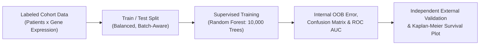

# Week 22: Machine Learning & Artificial Intelligence in Genomic Medicine — Core Concepts & Visualizations

**Course:** Applied Bioinformatics for Genomics (BFX Workshop 2025–2026)  
**Instructor:** Obi L. Griffith, Ph.D.  
**Transcription Model:** Whisper `large-v3-turbo` (`week_22_lecture.txt` / `week_22_lecture.srt`)

---

## 1. Evolution of AI, Machine Learning & Deep Learning in Biomedicine

- **Artificial Intelligence (AI):** Computer systems performing complex tasks requiring human-like intelligence (knowledge representation/ontologies like CIViC & Gene Ontology, natural language processing, perception, and learning).
- **Machine Learning (ML):** Algorithms that improve automatically from data without explicit rule-based programming:
  - **Unsupervised Learning:** Discovers latent patterns or clusters in unlabeled data (e.g., PCA, UMAP, hierarchical clustering of gene expression subtypes).
  - **Supervised Learning:** Trains a predictive model on **labeled examples** (e.g., `Relapse` vs. `No Relapse`) using feature matrices (e.g., $20,000$ gene expression values per patient) to classify unseen patients.
- **Deep Learning & Foundation Models / LLMs:** Multi-layered neural networks (`DeepVariant` pileup CNNs, `AlphaFold` protein structure prediction, `Dorado` Nanopore basecalling, and Large Language Models / Agentic Coding assistants).



---

## 2. Supervised Classification Case Study: Random Forests for ER+ Breast Cancer Relapse

In the 4-part Biostars R exercise, a **Random Forest (`randomForest` package)** classifier is trained on gene expression data to predict **5-year relapse vs. no relapse** in ER+ breast cancer patients:

### How a Random Forest Trains & Predicts (Ensemble of Decision Trees)
1. **Bootstrap Aggregating (Bagging):** For each of $N$ trees (e.g., `ntree = 10,000`), randomly sample patients with replacement (~2/3 **in-bag** training patients, ~1/3 **Out-Of-Bag [OOB]** held-out patients).
2. **Random Feature Subspace (`mtry`):** At every node split in a decision tree, randomly select a small subset of candidate genes (e.g., $\sqrt{P}$ genes) and pick the gene + expression threshold that best separates `Relapse` from `No Relapse`.
3. **Majority Vote & OOB Error:** Each tree votes on held-out OOB (or independent test) patients; the proportion of trees voting `Relapse` yields a continuous **predicted relapse probability**, avoiding overfitting without leaking test data!

```
               Decision Tree 1                  Decision Tree 2             ...     Decision Tree 10,000
              [Gene A > 3.2?]                  [Gene B < 1.5?]                      [Gene K > 5.0?]
               /           \                    /           \                        /           \
          Relapse       [Gene C > 1.8?]    No Relapse     Relapse               Relapse       No Relapse
                         /           \
                    Relapse       No Relapse
                     │                 │                  │                                │
                     └─────────────────┴──────────────────┴────────────────────────────────┘
                                                          │
                              Ensemble Majority Vote / Probability Score (e.g. 72% Relapse)
```

---

## 3. Evaluating Classifier Performance: Confusion Matrix, ROC/AUC & Survival

### A. Confusion Matrix & Class Imbalance Pitfalls
```
                              ACTUAL CLINICAL OUTCOME
                         Relapse (+)           No Relapse (-)
PREDICTED    Relapse (+) True Positive (TP)    False Positive (FP, Type I)
CLASS     No Relapse (-) False Negative (FN)   True Negative (TN)
```
- **Why Overall Accuracy Can Mislead:** If 90% of patients do not relapse, a trivial model predicting `"No Relapse"` for everyone achieves **90% accuracy** but **0% sensitivity**!
- **ROC Curve (Receiver Operating Characteristic) & AUC:** Plots **True Positive Rate (Sensitivity)** vs. **False Positive Rate ($1 - \text{Specificity}$)** across all probability cutoffs:
  - $\text{AUC} = 0.50$: Random coin flip (diagonal line).
  - $\text{AUC} = 1.00$: Perfect separation.
- **Kaplan-Meier Survival Analysis (`survival` / `survminer`):** Stratifies an independent test cohort by predicted risk group (`High Risk` vs. `Low Risk`) and tests whether relapse-free survival curves diverge significantly (**Log-Rank test $p$-value**).

---

## 4. Generative AI, LLMs & Agentic Coding in Bioinformatics (`Claude Code`, `Warp`, `ChatGPT`)

Dr. Griffith demonstrates practical applications and failure modes of modern LLMs in biomedical research:
1. **Literature Curation & Structured Extraction:** Uploading batches of clinical trial/genomic paper PDFs to extract structured patient tables (still requires human verification against missed/hallucinated rows).
2. **Code Translation & Agentic Container Building:** Using agentic terminals (`Warp`, `Claude Code`) to port legacy Perl/R scripts to Python or iteratively build and optimize multi-tool **Dockerfiles** (`griffithlab/rnaseq-toolkit`).
3. **Caveat Emptor (Critical Thinking Required):** Watch out for **hallucinated citations/functions**, **sycophancy** (agreeing with flawed user premises), **data leakage/privacy** with patient PHI, and **overfitting** when models are not tested on truly independent external cohorts.
