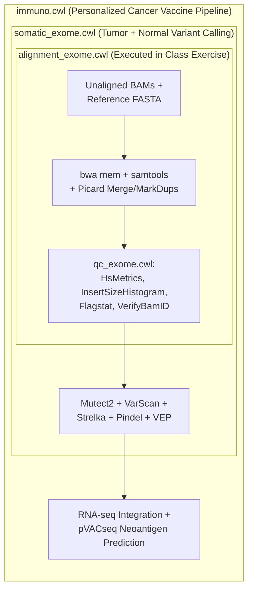

# Week 23: Genomic Workflows (`CWL`/`WDL`, `Cromwell`) & Cloud Computing (`GCP`)

**Course:** Applied Bioinformatics for Genomics (BFX Workshop 2025–2026)  
**Instructor:** John Garza & Chris Miller, Ph.D.  
**Transcription Model:** Whisper `large-v3-turbo` (`week_23_lecture.txt` / `week_23_lecture.srt`)

---

## 1. Why Move Beyond Ad-Hoc Bash Scripts to Formal Workflow Languages?

Processing a single genome or exome requires dozens of sequential and parallel tools (`bwa mem`, `samtools sort`, `Picard MarkDuplicates`, `CollectInsertSizeMetrics`, `HsMetrics`, `Mutect2`, `VarScan`, `VEP`). While wrapping commands in a `#!/bin/bash` script works for 1–2 samples, bash scripts break down at scale:

| Challenge | Ad-Hoc Bash Script (`run_pipeline.sh`) | Workflow Management System (`CWL`, `WDL`, `Nextflow`, `Snakemake`) |
| :--- | :--- | :--- |
| **Software Portability** | Hardcoded binary paths (`/usr/gitc/bwa`); fails on different machines | Every step declares its exact **Docker container image & tag** |
| **Resource Allocation** | Requests max RAM/CPUs (e.g., 64 GB) for the entire script duration | Per-task CPU/RAM declarations (`samtools flagstat` uses 1 CPU / 4 GB; `bwa` uses 16 CPUs) |
| **Crash Recovery (Checkpointing)** | Must manually edit script and check for truncated files after a mid-run failure | **Call-caching / Resume:** restarts automatically from the exact failed step |
| **Parallelism & Scaling** | Manual loops or `bsub`/`sbatch` submission scripts | Engine automatically parallelizes independent DAG branches across HPC or Cloud VMs |
| **Type Safety & Plumbing** | Typos in variable names fail silently or hours later | Strictly typed inputs/outputs (`File`, `String`, `Int`, `secondaryFiles` like `.bai`) validated upfront |

---

## 2. Modular Workflow Architecture: Tools, Sub-Workflows & Nested Pipelines

In the **Common Workflow Language (`CWL`)** repository (`genome/analysis-workflows`), individual command-line tools are wrapped as modular **building blocks ("Lego bricks")** and wired together into nested Directed Acyclic Graphs (**DAGs**):



### Anatomy of a `CWL` Tool Wrapper (`samtools_flagstat.cwl`)
1. **`requirements`:** Declares `ResourceRequirement` (`ramMin: 4000`, `coresMin: 1`) and `DockerRequirement` (`dockerPull: "mgibio/samtools-cwl:1.0.0"`).
2. **`baseCommand` & `inputs`:** Specifies `["/opt/samtools/bin/samtools", "flagstat"]` and typed input parameters (`bam: type: File`).
3. **`stdout` & `outputs`:** Captures `$(inputs.bam.basename).flagstat` as a formal output `File` that downstream workflow steps can consume.

---

## 3. FAIR Data Principles & Public Genomic Repositories

True reproducibility requires pairing open-source, version-controlled workflows with **FAIR data** (**F**indable, **A**ccessible, **I**nteroperable, **R**eproducible):
- **NCBI SRA (Sequence Read Archive) & dbGaP:** Raw sequencing reads (`FASTQ`/`BAM`), with controlled-access human clinical/germline governance via **dbGaP**.
- **NCBI GEO (Gene Expression Omnibus):** Processed functional genomics matrices and metadata (RNA-seq, scRNA-seq, ChIP-seq).
- **Zenodo / Institutional Repositories:** Assign permanent, citable **DOIs** to code snapshots, custom reference bundles, and supplemental datasets (never rely on ephemeral lab websites or personal cloud buckets!).

---

## 4. Scientific Cloud Computing (`GCP`) & Running `Cromwell` Hands-On

Unlike shared university HPC clusters (which use an NFS shared filesystem and `LSF`/`SLURM` queues), **Cloud Computing (Google Cloud Platform `GCP`, AWS)** spins up isolated Virtual Machines (**VMs**) on demand:
1. **Localize:** Download input files from a Cloud Storage Bucket (`gs://...`) onto the VM disk.
2. **Compute:** Pull the Docker container and execute the workflow task.
3. **De-localize & Terminate:** Upload outputs back to `gs://` and destroy the VM so you stop paying for compute.
   - *Rule of Thumb:* Perform small exploratory testing on local/in-house compute, and use the cloud for large-scale production runs or elastic bursts (e.g., analyzing >50,000 WGS samples in parallel).

```bash
# 1. Download Cromwell workflow engine (v79 supports both WDL and CWL) & example inputs in GCP Cloud Shell
wget https://github.com/broadinstitute/cromwell/releases/download/79/cromwell-79.jar
docker run -v $PWD:/staging mgibio/data_downloader:0.1.0 gsutil -m cp -r gs://analysis-workflows-example-data /staging/
sudo chown -R $USER:$USER analysis-workflows-example-data/

# 2. Clone CWL workflow definitions and YAML input mapping
git clone https://github.com/genome/analysis-workflows.git
wget https://raw.githubusercontent.com/genome/bfx-workshop/refs/heads/master/archive/v2024-2025/lectures/week_20/alignment_exome.yaml

# 3. Execute alignment_exome.cwl via Cromwell and tee stdout to cromwell.log to inspect JSON output paths
java -jar cromwell-79.jar run -t cwl -i alignment_exome.yaml \
  analysis-workflows/definitions/pipelines/alignment_exome.cwl | tee cromwell.log
```
