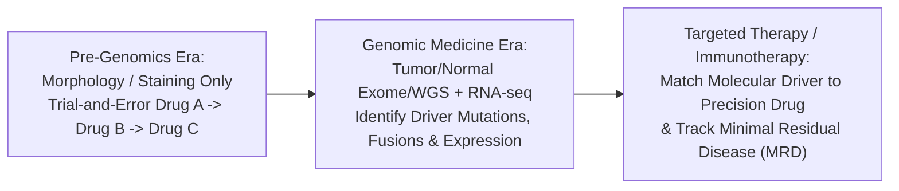

# Week 24: Genomic Medicine & Course Synthesis — Core Concepts & Visualizations

**Course:** Applied Bioinformatics for Genomics (BFX Workshop 2025–2026)  
**Instructor:** Chris Miller, Ph.D.  
**Transcription Model:** Whisper `large-v3-turbo` (`week_24_lecture.txt` / `week_24_lecture.srt`)

---

## 1. The Paradigm Shift to Personalized Genomic Medicine

Before clinical genomics, cancer treatment relied on tissue-of-origin histopathology and trial-and-error chemotherapy ("try Drug A; if no response, try Drug B"). **Personalized genomic medicine** uses molecular profiling (DNA/RNA sequencing) to deliver **the right treatment to the right patient at the right time**.



### Landmark Early Example: *EGFR* Kinase Mutations in Never-Smoker Lung Cancer
- Sequencing candidate tyrosine kinase genes across responders vs. non-responders to the EGFR inhibitor **gefitinib (Iressa)** revealed that **~80% of responders carried activating somatic mutations in the *EGFR* tyrosine kinase domain** (Pao et al., *PNAS* 2004).
- Testing for *EGFR* mutations upfront transforms an experimental drug with modest unselected response rates into a highly effective first-line targeted therapy.

---

## 2. Cancer Is Not One Disease: Genomic Heterogeneity & Actionable Drivers

High-throughput profiling of cohorts like **TCGA Acute Myeloid Leukemia (AML, 200 patients)** demonstrated that morphologically similar tumors are driven by distinct, often **mutually exclusive or co-occurring** molecular pathways (e.g., *PML-RARA* fusions, *NPM1* + *FLT3* + *DNMT3A* co-mutation, *TP53* + complex karyotype).

```
             MOLECULAR SUBCLASSIFICATION OF AML (Co-Occurrence vs Mutual Exclusivity)
Patients ──►  | P1 P2 P3 P4 P5 P6 P7 P8 | P9 P10 P11 P12 | P13 P14 P15 |
──────────────┼─────────────────────────┼────────────────┼─────────────┤
NPM1          | ██ ██ ██ ██ ██ ██ ██ ██ |  ·   ·   ·   · |   ·   ·   · |  Co-occurs with DNMT3A / FLT3
DNMT3A        | ██ ██ ██ ██ ██  ·  ·  · |  ·   ·   ·   · |   ·   ·   · |
FLT3-ITD      | ██ ██ ██  ·  · ██ ██  · |  ·   ·   ·   · |   ·   ·   · |
PML-RARA t(15;17)| ·  ·  ·  ·  ·  ·  ·  · | ██  ██  ██  ██ |   ·   ·   · |  Mutually exclusive; cured by ATRA + Arsenic!
TP53          |  ·  ·  ·  ·  ·  ·  ·  · |  ·   ·   ·   · |  ██  ██  ██ |  Adverse risk; complex karyotype
```

---

## 3. Clinical Case Studies in Whole-Genome & Transcriptome Medicine

### Case Study 1: Cryptic *PML-RARA* Fusion in Acute Promyelocytic Leukemia (APL)
- **Clinical Dilemma:** A patient presented with AML morphology where standard cytogenetics (G-banding karyotype and FISH) showed a complex rearrangement and **failed to detect the classic $t(15;17)$ translocation**, risking assignment to toxic, high-risk stem-cell transplant instead of curative **ATRA (all-trans retinoic acid) + arsenic trioxide** differentiation therapy.
- **Genomic Resolution:** Clinical **Whole-Genome Sequencing (WGS)** completed in <7 days revealed a **cryptic cytogenetically invisible insertion** creating a functional ***PML-RARA* fusion gene**. The patient received ATRA therapy and achieved complete remission without transplant!

### Case Study 2: *FLT3* Overexpression Driven by RNA-seq in Relapsed ALL (Dr. Lukas Wartman)
- **Clinical Dilemma:** Physician-scientist Dr. Lukas Wartman suffered a second relapse of Adult Acute Lymphoblastic Leukemia (ALL) with no known targetable DNA driver mutations in his tumor WGS/Exome.
- **Genomic Resolution (Integrated WGS + RNA-seq):**
  - **RNA-seq** revealed extreme outlier overexpression of wild-type ***FLT3*** receptor tyrosine kinase.
  - Off-label treatment with the tyrosine kinase inhibitor **sunitinib** cleared blasts and induced a **complete clinical remission in 12 days**, bridging him to a curative stem-cell transplant (>13 years in remission!).

```
Timeline (Days):   0 (Relapse: 80% Blasts) ──► WGS + RNA-seq (FLT3 Outlier!) ──► Day 15: Start Sunitinib ──► Day 27: 0% Blasts (Remission -> SCT!)
```

---

## 4. Synthesis of Foundational Bioinformatics Skills (Weeks 1–24)

| Competency Pillar | Core Tools, Formats & Concepts Mastered |
| :--- | :--- |
| **1. Computing Environments & Reproducibility** | Unix shell (`bash`, pipes, `awk`, `sed`), **Docker** containers (`-v` volume mounts), HPC clusters (`LSF`/`SLURM`), **CWL/WDL (`Cromwell`)** workflows, and **Google Cloud (GCP)** |
| **2. Standard Genomic Data Formats** | `FASTQ` (Phred+33), `SAM`/`BAM`/`CRAM` (flags, `MAPQ`, `CIGAR`), `BED` (0-based half-open), `GTF` (1-based exons), `VCF` (genotypes, `VAF`), `GFA`/`GBZ` (pangenome graphs) |
| **3. Primary & Secondary Omics Pipelines** | Short/long-read DNA alignment (`BWA-MEM`, `minimap2`), variant calling & annotation (`GATK HaplotypeCaller`, `Mutect2`, `VarScan`, `VEP`), bulk & single-cell RNA-seq (`HISAT2`, `StringTie`, `Ballgown`, `Seurat`, `Harmony`), Epigenomics (`MACS2`, `Bismark`), 16S (`QIIME2`), and ML/AI |
| **4. Rigorous Quality Control & Skepticism** | **Visualize your data** (`IGV`, `FastQC`, `ggplot2`), include **positive and negative computational controls**, match technical covariates, and *never trust your data until you have exhausted every alternative explanation!* |
