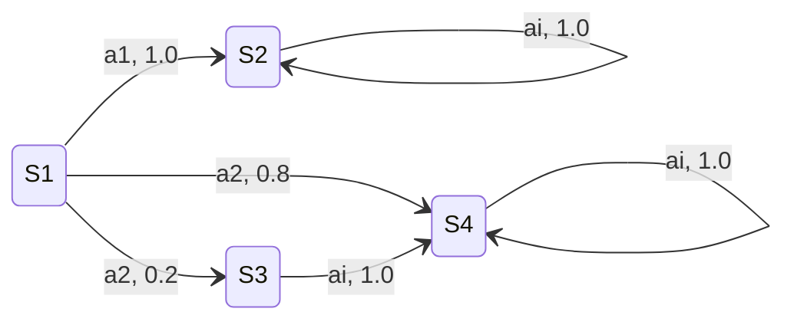
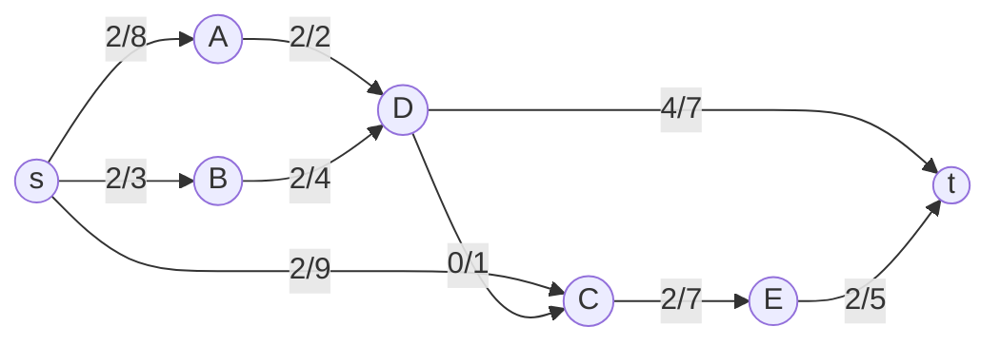

# CS 6515/4540 - Exam 1

**Term:** Fall 2025  
**Name:** ______________________________  
**GTID:** ______________________________  
**GT Username:** ______________________________

## Instructions

1. When the exam starts, write your name, GTID, or GT Username on each page.
2. Bringing two pages of notes is permitted.
3. No books, calculators, or other electronic devices are permitted.
4. Make your answers clear and concise.
5. This examination contains **9 (nine) pages**. Verify that no pages are missing.
6. **Only write on the front of each sheet.** Backs will not be scanned.
7. You may refer to standard algorithms from class without giving full pseudocode.

> I am aware of and in accordance with the Academic Honor Code of Georgia Tech and the Georgia Tech Code of Conduct. I will use no person's help on this test. Also, I have read all the instructions on this page.

**Signature:** ______________________________

---

# 1. Short Answer Questions (35 points)

> Unless explicitly mentioned, a short 1-2 line justification is required.

## Question 1

**No justification required.** What is the smallest odd number $M$ for which running the Median-of-Medians algorithm with groups of $M$ numbers still yields a linear runtime?

**Answer:**

<br><br>

## Question 2

Given $n \ge 4$, we test primality by checking divisibility for all integers

$$
2 \le i \le \left\lfloor \sqrt{n} \right\rfloor.
$$

This is a polynomial-time algorithm in the input size.

- [ ] True
- [ ] False

**Justification:**

<br><br>

## Question 3

Suppose $k = \log n$. Then

$$
k^k = \Theta(n).
$$

- [ ] True
- [ ] False

**Justification:**

<br><br>

## Question 4

Let $M$ and $M'$ be two matchings in a bipartite graph $G$. Consider the symmetric difference

$$
\Delta = M \oplus M'.
$$

Then $\Delta$ may contain a cycle of length $7$.

- [ ] True
- [ ] False

**Justification:**

<br><br>

## Question 5

Given a weighted graph $G=(V,E)$, let $e=(u,v)$ be the lightest edge incident to $u$. Then $e$ is in **some** minimum spanning tree of $G$.

- [ ] True
- [ ] False

**Justification:**

<br><br>

## Question 6

Consider the Markov decision process with four states $\{S_1,S_2,S_3,S_4\}$ and two actions $\{a_1,a_2\}$, as shown below. A tuple $(a,p)$ on an edge means that performing action $a \in \{a_1,a_2\}$ at the source state leads to the destination state with probability $p$. A label $a_i$ means that the transition applies to both $a_1$ and $a_2$.



The reward received when pulling either action is:

| State | Reward |
|:---:|---:|
| $S_1$ | $0$ |
| $S_2$ | $10$ |
| $S_3$ | $100$ |
| $S_4$ | $0$ |

Starting at $S_1$, what is the optimal policy for horizon $T=2$? Justify briefly.

**Answer:**

<br><br><br>

## Question 7

A polynomial-time approximation scheme, or PTAS, achieves a $(1-\epsilon)$-approximation in time polynomial in both the input size and $1/\epsilon$.

- [ ] True
- [ ] False

**Justification:**

<br><br>

---

# 2. Graphs (20 points)

Consider the following $st$-flow $f$ in a directed graph $G$, where $a/b$ on an edge denotes flow $a$ and capacity $b$.



## Question 1 (6 points)

Draw the residual graph $G^f$. Use the convention that, for each ordered pair $(u,v)$, the diagram shows the residual capacity.


## Question 2 (3 + 3 points)

Find an augmenting path $P$, or state that none exists, that sends at least $3$ units of flow. If $P$ exists, send $3$ units of flow along $P$ and draw the resulting flow $f'$.

**Augmenting path:**

<br><br>

**Resulting flow $f'$:**


## Question 3 (4 points)

What is the value of the maximum $st$-flow in $G$?

**Answer:**

<br><br>

## Question 4 (4 points)

List the edges of a minimum $st$-cut of $G$.

**Answer:**

<br><br>

---

# 3. Divide and Conquer (25 points)

Given an array

$$
A[0],A[1],\ldots,A[n-1],
$$

count the number of inversions, meaning pairs $(i,j)$ such that

$$
i<j \quad \text{and} \quad A[i]>A[j],
$$

in $O(n\log n)$ time.

## Question 1 (5 points)

Design `MergeAndCount(X, Y)`, which takes two **sorted** arrays and returns:

1. the merged sorted array, and
2. the number of pairs $(i,j)$ such that $X[i]>Y[j]$.

**Example:**

```text
MergeAndCount([1, 5], [2, 3]) -> [1, 2, 3, 5] and 2
```

**Answer:**

```text


```

## Question 2 (10 points)

Using `MergeAndCount`, which you may assume is implemented, design a divide-and-conquer algorithm to count inversions in $A$. Give a high-level description of the recursion.

**Answer:**

<br><br><br><br>

## Question 3 (10 points)

Assume $n=2^k$ and the runtime satisfies

$$
T(1)=1,
$$

and, for $n\ge 2$,

$$
T(n)=2T\left(\frac{n}{2}\right)+n.
$$

Prove by induction, without using the Master Theorem, that

$$
T(n)=O(n\log n).
$$

**Proof:**

<br><br><br><br><br><br>

---

# 4. Dynamic Programming (20 points)

You are given a knapsack with budget $B\in\mathbb{Z}_{>0}$ and $n$ items. Item $i$ has:

- size $s_i\in\{1,\ldots,B\}$, and
- value $v_i\in\mathbb{Z}_{>0}$.

Choose a subset $I\subseteq\{1,\ldots,n\}$ satisfying

$$
\sum_{i\in I}s_i \le B
$$

that maximizes

$$
\sum_{i\in I}v_i.
$$

Each item may be chosen at most once. Design a dynamic program whose running time depends only on $n$ and $B$. Terms involving $\log v_i$ due to bit complexity may be ignored.

## Question 1 (5 points)

Define the entries $T(i,b)$ of the DP table, where

$$
i\in\{1,\ldots,n\}, \qquad b\in\{1,\ldots,B\}.
$$

**Answer:**

<br><br><br>

## Question 2 (8 points)

Give the recurrence in terms of smaller subproblems and briefly justify its correctness.

**Recurrence and justification:**

<br><br><br><br>

## Question 3 (7 points)

Analyze the runtime in terms of $n$ and $B$. Is the algorithm polynomial-time in the input size?

**Answer:**

<br><br><br>

---

# End of Exam

> **Formatting note:** The graph and MDP figures were transcribed as Mermaid diagrams so they remain editable and render cleanly in Markdown viewers with Mermaid support.
