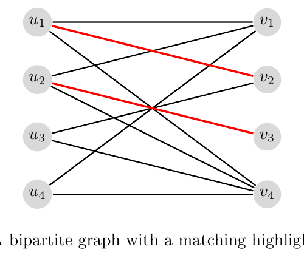

# Practice Problems - CS 6515/4540 (Fall 2026)

*Collection of problems for students to practice*

## 1. Short Answer Practice

Unless explicitly mentioned, a short 1-2 line justification is required.

### 1.1

**True or False:** Consider computing the $n$th Fibonacci number $F(n)$, defined by

$$
F(0)=1, \qquad F(1)=1,
$$

and

$$
F(i)=F(i-1)+F(i-2) \qquad \text{for all integers } i\ge 2.
$$

We need $\Theta(n)$ space to compute $F(n)$ because we have to store the entire dynamic-programming table. Assume integers take $O(1)$ space to represent.

### 1.2

Suppose

$$
f'\in O(f(n)) \qquad \text{and} \qquad g'\in O(g(n)).
$$

Is it necessarily true that

$$
f'g'\in O\bigl(f(n)g(n)\bigr)?
$$

What happens if $\Theta$ is used instead of Big-O?

### 1.3

Given a Markov decision process in which the transition probability from state $s$ to state $s'$ under action $a$ satisfies

$$
P_a(s,s')\in\{0,0.5,1\},
$$

is it possible to solve for $V^*(s,t)$ in

$$
o\bigl(|S|^2|A|T\bigr)
$$

time?

### 1.4

**True or False:** The median-finding algorithm with $M=\sqrt{n}$ results in an $O(n)$ algorithm.

### 1.5

**True or False:** There exists a polynomial-time algorithm for knapsack when, for every job $i$,

$$
v_i\in\{1,2,3,\ldots,10\}.
$$

### 1.6

**True or False:** If every edge weight in a connected, undirected graph is distinct, then the minimum spanning tree (MST) of the graph is unique.

### 1.7

**True or False:** Consider a matching $M$ on a graph $G$ that has only augmenting paths of length 11 or greater. For every path or cycle in the symmetric difference between $M$ and $M'$, where $M'$ is a maximum matching, the ratio of blue edges in $M$ to red edges in $M'$ must be at least

$$
\frac{5}{6}.
$$

## 2. Divide and Conquer

The Strassen algorithm for multiplying two $n\times n$ matrices uses seven multiplications of matrices of size $\frac{n}{2}\times\frac{n}{2}$ and a constant number of matrix additions. If adding two $n\times n$ matrices takes $O(n^2)$ time, determine the time complexity of Strassen's algorithm.

1. State the recurrence for the runtime of Strassen's algorithm.
2. Is the time complexity $O(n^{2.5})$?
3. Is it $o(n^3)$?

## 3. Dynamic Programming

### 3.1 Longest Non-Mod-2 Subsequences

You are given two integer arrays, `arr1` of length $m$ and `arr2` of length $n$. Design a dynamic-programming algorithm to find the longest non-mod-2 subsequences between the two arrays.

The longest non-mod-2 subsequences are the longest equal-length subsequences $S$ of `arr1` and $T$ of `arr2` for which

$$
(S[i]\bmod 2)\ne(T[i]\bmod 2) \qquad \forall i.
$$

The running time of your algorithm should be $O(n^2)$.

**Example input**

```text
arr1 = [5, 7, 6, 4, 1, 8, 9]
arr2 = [3, 10, 7, 9, 4]
```

**Example output**

```text
4
```

This is because one valid pair is

```text
S = [5, 6, 8, 9]
T = [10, 7, 9, 4]
```

There are multiple non-mod-2 subsequences of length 4. However,

```text
S = [7, 6, 4, 8]
T = [10, 7, 9, 4]
```

is not a valid answer because, at index $i=3$,

$$
4\bmod 2=8\bmod 2.
$$

Answer the following:

1. Define the entries of your table in words. For example, "$T(i)$ or $T(i,j)$ is ..."
2. State a recurrence for the table entries in terms of smaller subproblems. Briefly explain why it is correct.
3. Analyze the running time of your algorithm.

### 3.2 Stock Selection Under a Budget

You are given two integer arrays of the same length,

```text
present[0, 1, ..., n-1]
future[0, 1, ..., n-1]
```

where `present[i]` and `future[i]` represent the present and future prices of stock $i$. You can buy and sell each stock at most once, and you are given a `budget` amount. Provide an algorithm that maximizes your profit under these constraints. Explain why your algorithm is correct and analyze its runtime.

**Example input**

```text
present = [5, 4, 6, 2, 3]
future  = [8, 5, 4, 3, 5]
budget  = 10
```

**Example output**

```text
6
```

**Explanation:** Buy stocks 0, 3, and 4 for a total of

$$
5+2+3=10.
$$

Next year, sell all three stocks for

$$
8+3+5=16.
$$

The resulting profit is

$$
16-10=6.
$$

It can be shown that 6 is the maximum possible profit.

Answer the following:

1. Give the recurrence equation. Briefly explain why your algorithm works, and write the algorithm.
2. Analyze its runtime.

### 3.3 Longest Close Subsequences

Two arrays $X$ and $Y$ are considered **close** if

$$
|X[i]-Y[i]|\le 1 \qquad \text{for all } i,
$$

and

$$
|X|=|Y|.
$$

Given two integer arrays $A$ and $B$, each of length $n$, find the length of the longest subsequences $C$ and $D$ of $A$ and $B$, respectively, such that $C$ and $D$ are close.

Array $C$ is a subsequence of $A$ if there exists a sorted set of indices $I$ such that

$$
C[i]=A[I_i] \qquad \text{for all } i\in\{1,2,\ldots,\operatorname{len}(C)\}.
$$

Your algorithm should run in $O(n^2)$ time.

## 4. Graph Algorithms

### 4.1 Distance to the Nearest Zero

Given an $m\times n$ binary matrix `mat`, write an algorithm that returns an updated matrix containing the distance from each cell to the nearest 0. Briefly explain why your algorithm is correct and analyze its runtime.

Two cells are at distance 1 if they share a side. Diagonally connected cells are not at distance 1.

**Example 1**

Input:

$$
\begin{bmatrix}
0&0&0\\
0&1&0\\
0&0&0
\end{bmatrix}
$$

Output:

$$
\begin{bmatrix}
0&0&0\\
0&1&0\\
0&0&0
\end{bmatrix}
$$

**Example 2**

Input:

$$
\begin{bmatrix}
0&0&0\\
0&1&0\\
1&1&1
\end{bmatrix}
$$

Output:

$$
\begin{bmatrix}
0&0&0\\
0&1&0\\
1&2&1
\end{bmatrix}
$$

### 4.2 Paths with Lexicographically Minimized Edge Colors

Given a graph $G=(V,E)$ whose edges are colored red or blue, consider all paths from $s\in V$ to $t\in V$ that use the minimum possible number of red edges. Among those paths, find one that uses the minimum number of blue edges.

### 4.3 Edmonds-Karp Runtime

In class, we proposed the Ford-Fulkerson algorithm for maximum flow in a flow network. The algorithm repeatedly finds an augmenting path $P$ in the residual graph[^1] and updates the flow so that at least one edge on $P$ is saturated.[^2]

The algorithm used to find an augmenting path is not specified in Ford-Fulkerson. In the Edmonds-Karp algorithm, breadth-first search (BFS) is used to find an augmenting path in the residual graph. This algorithm terminates in polynomial time.

It can be shown that, for any two vertices $u$ and $v$ in the network, the directed edge $(u,v)$ is saturated in the residual graph no more than $|V|/2$ times.

Using this fact, show that the Edmonds-Karp algorithm terminates in polynomial time. Give its time complexity in terms of the number of vertices $|V|$ and edges $|E|$.

[^1]: Keep in mind that the residual graph has twice as many edges as the original network.
[^2]: In class, augmenting paths were used to increase the total flow one unit at a time. Instead, increase the flow by as much as the augmenting path permits, namely the capacity of the minimum-capacity residual edge on the path.

### 4.4 Augmenting Paths in a Bipartite Matching

Compute at least five different augmenting paths for the matching shown below.



*Figure 1: A bipartite graph with a matching highlighted in red.*

### 4.5 Hall's Condition and Perfect Matchings

Let $G=((A,B),E)$ be a bipartite graph with parts $A$ and $B$ and edge set $E$.

1. Prove by contradiction that if

   $$
   |\operatorname{Nbr}(S)|\ge |S| \qquad \text{for every } S\subseteq A,
   $$

   then every maximum matching $M$ matches every vertex of $A$.

   **Hint:** Assume that the maximum matching $M$ leaves some vertex $x\in A$ unmatched. Consider all alternating paths starting at $x$ and argue that an augmenting path must exist, contradicting the maximality of $M$ because the size of $M$ could be increased by 1.

2. Suppose a bipartite graph is $d$-regular, meaning that every vertex has the same positive degree $d$ (for example, $d=10$). Use Part 1 to deduce that the graph has a perfect matching.

### 4.6 Updating a Unit-Capacity Maximum Flow

Let $G=(V,E)$ be a directed graph in which every edge has capacity 1. For given vertices $s\ne t\in V$, let $f$ be an integral $s$-$t$ maximum-flow vector, where the integer $f_e$ denotes the flow through edge $e\in E$.

1. An edge $e\notin E$ with capacity 1 is added to the graph, so $f$ might no longer be a maximum flow. Construct an $O(|V|+|E|)$-time algorithm that, given $G,s,t,f,e$, returns a new $s$-$t$ maximum flow $f'$ valid on

   $$
   G'=(V,E\cup\{e\}).
   $$

2. An edge $e\in E$ is deleted from the graph, so $f$ might no longer be a valid maximum flow. Construct an $O(|V|+|E|)$-time algorithm that, given $G,s,t,f,e$, returns a new $s$-$t$ maximum flow $f'$ valid on

   $$
   G'=(V,E\setminus\{e\}).
   $$

For both parts, provide an algorithm description, proof of correctness, and complexity analysis.
