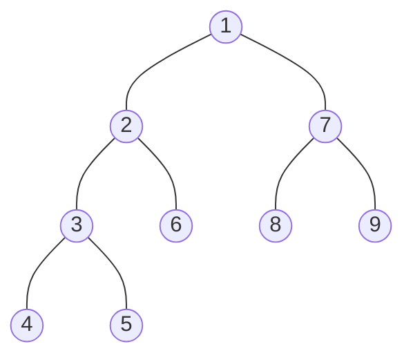
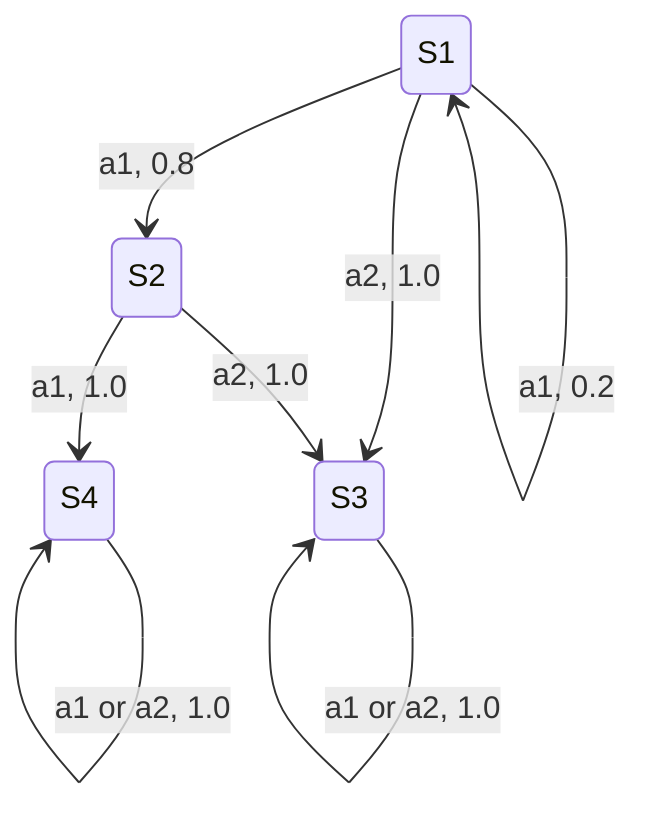

# DP and Graph Algorithms

## Problem Set 2: CS 6515/4540 (Fall 2026)

**Due:** Thursday, September 17  
**Submission:** Gradescope

Your solution must be a typed PDF, for example via LaTeX. Handwritten solutions are not accepted.

---

## 4. DP: Balancing Array

Given an array of $n$ **nonnegative** integers $A$ and an integer $k$, we want to partition $A$ into $k$ contiguous, nonempty subarrays such that the subarray with the largest sum is minimized. Let the minimum achievable largest sum be $S$.

Provide an algorithm to compute $S$ as efficiently as possible using dynamic programming.

### Example

Let

$$
A = [1, 4, 6, 2, 5], \qquad k = 3.
$$

The most balanced partition is

$$
[1,4], \quad [6], \quad [2,5],
$$

and therefore

$$
S = \max(1+4, 6, 2+5) = 7.
$$

### Questions

1. Define the entries of your table in words. For example, explain what $T(i)$ or $T(i,j)$ represents.
2. State a recurrence for the entries of the table in terms of smaller subproblems. Briefly explain why it is correct.
3. Analyze the running time of your algorithm. First show how this can be done in $O(kn^2)$ time, and then improve it to $O(kn\log n)$ time.

> **Remark:** There is a more efficient solution without using dynamic programming that eliminates any dependency on $k$.

---

## 5. DP: Minimum Lights

The Georgia Tech campus spans $n$ academic buildings, with interconnecting pathways that form a tree $T=(V,E)$. The campus police want to ensure that all pathways are illuminated at night.

Lights can be installed on any building $B \in V$. Installing a light on $B$ illuminates every pathway, or edge, incident to $B$.

Your goal is to develop a dynamic programming strategy that finds the minimum number of lights needed to illuminate the entire campus. You are given an unweighted, undirected tree with $n$ vertices and $m$ edges, where each vertex represents an academic building and each edge represents a pathway.

Find a set $S \subseteq V$ such that every edge $e \in E$ is incident to at least one vertex in $S$, while minimizing $|S|$.

The running time of your algorithm should be $O(|V|)$.

### Example Input

### Example Output

The minimum number of lights is **3**. The buildings where lights should be installed are

$$
\{2,3,7\}.
$$

### Questions

1. Define the entries of your table in words. For example, explain what $T(i)$ or $T(i,j)$ represents.
2. State a recurrence for the entries of the table in terms of smaller subproblems. Briefly explain why it is correct.
3. Analyze the running time of your algorithm.

---

## 6. PTAS for Knapsack

Recall the Knapsack problem. We have a budget $B$ and $n$ items labeled $i$, where $1 \le i \le n$. Item $i$ has weight $s_i \le B$ and value $v_i$. We want to compute a subset with maximum total value

$$
\sum_{i \in I} v_i
$$

among all subsets $I \subseteq [n]$ satisfying

$$
\sum_{i \in I} s_i \le B.
$$

### Questions

1. Show that the PTAS given in lecture, where we apply the $O(n^2 \max_i v_i)$ dynamic programming algorithm after truncating values to their nearest smaller multiple of $K$, returns a feasible subset with total value $V$ satisfying

   $$
   1-\frac{nK}{\max_i v_i} \le \frac{V}{V'} \le 1,
   $$

   where $V'$ is the optimal value for the original problem.

2. Choose an appropriate value of $K$ in terms of $\epsilon$ and $\max_i v_i$ so that

   $$
   \frac{V}{V'} \ge 1-\epsilon
   $$

   in $\operatorname{poly}(n,1/\epsilon)$ time.

3. Suppose there exists an approximation algorithm that, in polynomial rather than pseudopolynomial time, obtains a $(1-\epsilon)$-approximation for Knapsack when

   $$
   \epsilon < \frac{1}{n\max_i v_i}.
   $$

   Show that $P=NP$.

---

## 7. MDP

### 7.1 Solving a Small MDP

Consider a Markov decision process with four states

$$
\{S_1,S_2,S_3,S_4\}
$$

and two actions

$$
\{a_1,a_2\},
$$

as shown below. A tuple $(a,p)$ on an edge means that performing action $a \in \{a_1,a_2\}$ at the source state leads to the destination state with probability $p$. The label $a_i$ indicates that the transition applies to both $a_1$ and $a_2$.

The rewards are:

- Pulling either action from $S_1$ or $S_2$ gives reward $0$.
- Pulling either action from $S_3$ gives reward $10$.
- Pulling either action from $S_4$ gives reward $100$.

Suppose we start at $S_1$. What is the optimal policy for time horizon $T=2$, meaning that only two actions may be taken? Justify your answer briefly.

### 7.2 MDPs with Approximate Rewards

Consider any MDP with finite time horizon $T$. Suppose we replace each reward $r_a(s)$ with an approximate reward $\widehat r_a(s)$ satisfying

$$
\left|r_a(s)-\widehat r_a(s)\right| \le \epsilon
\qquad
\text{for every state $s$ and action $a$},
$$

where $\epsilon>0$. All transition probabilities remain unchanged.

Let $\widehat\pi$ be an optimal policy for the modified MDP. Show that following $\widehat\pi$ in the **original** MDP gives expected total reward at least

$$
\mathrm{OPT}-2T\epsilon,
$$

where $\mathrm{OPT}$ is the optimal expected total reward in the original MDP. You do not need to compute either optimal policy.

---

## 8. Walking on the Plane

Consider $n$ points on the Euclidean plane. Each point is the center of a dynamically changing circle whose radius grows linearly with time. In particular, the radius of each circle at time $t$ is $t$.

Given two vertices $u$ and $v$, design an algorithm that finds the earliest time $t$ at which $u$ and $v$ become connected. That is, after freezing time at $t$, it must be possible to walk from $u$ to $v$ on the Euclidean plane while remaining inside at least one circle at every point along the path.

### Questions

1. Solve the problem in $O(n^2\log n)$ time, or better, using a modification of Dijkstra's algorithm. Describe the modified algorithm using pseudocode and explain why the modifications solve the problem.
2. Consider a different perspective: treat the $n$ points as the vertices of a weighted complete graph, where each edge weight is the Euclidean distance between its endpoints. If a minimum spanning tree of this graph is explicitly given, show that the problem can be solved in linear time.

> **Remark:** This problem can be solved in $O(n\log n)$ time by computing the Delaunay triangulation.

---

## 9. Bipartite Matching: Forbidden Paths

We are given a directed graph

$$
G=(V,E), \qquad V=\{v_1,\ldots,v_n\},
$$

and a forbidden set

$$
F=\{f_1,f_2,\ldots,f_k\} \subset V.
$$

Define a bipartite graph

$$
\widehat G=(L\cup R,\widehat E)
$$

as follows:

- $L=\{v_1,\ldots,v_n\}$.
- $R=\{v'_1,\ldots,v'_n\}$, so the left and right sides contain two copies of $V$.
- Add the edge $\{v_i,v'_i\}$ to $\widehat E$ for every $i=1,\ldots,n$.
- Add the edge $\{v_i,v'_j\}$ to $\widehat E$ for every directed edge $(v_i,v_j)\in E$.

Given two distinct vertices $v_s,v_t\in V$:

1. Delete $v'_s$ from $R$.
2. Delete $v_t$ from $L$.
3. For each $f_i\in F$, delete $f_i$ from $L$ and $f'_i$ from $R$.
4. Whenever a vertex is deleted, also delete all incident edges from $\widehat E$.

### Problem

Show both directions of the following equivalence:

A perfect matching exists in $\widehat G$ **if and only if** there is a directed path from $v_s$ to $v_t$ in $G$ that avoids every vertex in

$$
F \subseteq V\setminus\{v_s,v_t\}.
$$

---

## Practice Problem: Another Pseudopolynomial-Time Algorithm

> This problem is for practice and will not be graded.

Consider again the Knapsack problem from class, where all item sizes and values are positive integers. Design a dynamic programming algorithm with running time $O(nB)$, where $B$ is the capacity of the knapsack. Assume that numbers can be added or subtracted in $O(1)$ time.

This algorithm should be efficient when the capacity is small, without requiring the item values to be small.

### Questions

1. Define the entries of your table in words. For example, explain what $T(i)$ or $T(i,j)$ represents.
2. State a recurrence for the entries of the table in terms of smaller subproblems. Briefly explain why it is correct.
3. Analyze the running time of your algorithm.
